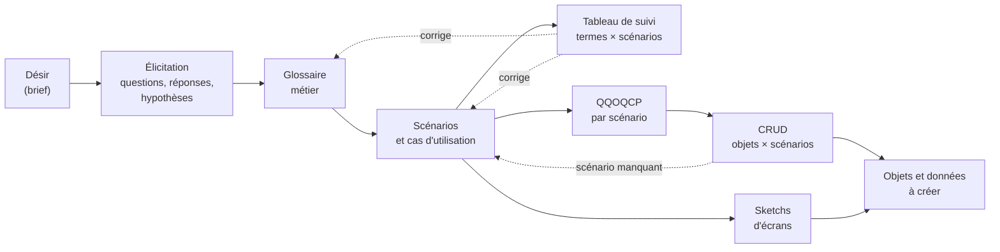

# Pourquoi refaire ce meetup

Le meetup du 28 mars 2024 ([[MU 00 Développement Logiciel avec l'IA]]) montrait comment mener une analyse avec ChatGPT dans un navigateur : on collait le cahier des charges, on recopiait les réponses dans Obsidian, et le modèle perdait le fil tous les sept ou huit prompts. L'autocomplétion de Copilot écrivait ensuite le code ligne à ligne.

En 2026, l'outil a changé de nature. Claude Code et Codex sont des **agents** : ils lisent le dépôt, écrivent les fichiers, lancent les commandes, relisent leur propre travail et gardent leurs consignes dans des fichiers versionnés. On ne copie plus rien.

| | Meetup 2024 | Meetup 2026 |
| --- | --- | --- |
| Outil | ChatGPT dans le navigateur, Copilot dans l'éditeur | Claude Code et Codex dans le terminal, sur le dépôt |
| Contexte | La conversation, perdue au bout de quelques prompts | Le dépôt : consignes, glossaire et scénarios sont des fichiers que l'agent relit |
| Livrable | Du texte à recopier | Des fichiers écrits, validés et commités |
| Vérification | À l'œil | Scripts, schéma, et contre-lecture par un second agent |
| Étude de cas | Un script qui publie des notes Markdown en HTML | Kunereti, un outil de délibération sans serveur, démarré de zéro |
| Rôle de l'humain | Poser les questions, corriger les hallucinations | Dire le besoin, trancher, relire ; l'agent pose une partie des questions |

Ce qui n'a pas changé, c'est la méthode. Un agent amplifie la méthode que l'on a ; sans méthode, il produit du volume. Le meetup montre donc la même phase d'analyse qu'en 2024 (celle de 2TUP, fondée sur les cas d'utilisation), outillée autrement et poussée plus loin : élicitation, glossaire, scénarios, tableau de suivi, QQOQCP, CRUD et croquis d'écrans.

> [!warning] Ce que sont les transcriptions
> Kunereti est en cours de réalisation et rien n'est encore implémenté. Les livrables cités (glossaire, scénarios, croquis) existent dans ce coffre. Les prompts, eux, sont **reconstitués** : le projet réel est né d'une réflexion sur la modernisation de KuneAgi, alors que le meetup le raconte comme un démarrage de zéro. Les prompts qui manquaient ont été imaginés, et les réponses des agents sont résumées. Les chiffres du tableau de suivi ([[MU26 06 Tableau de suivi glossaire-scénarios]]) sont en revanche calculés sur les fichiers réels.

# L'étude de cas : Kunereti

Kunereti est un outil de délibération et d'innovation participative **sans serveur central**. Les membres d'une communauté disent ce qu'ils ont à dire ; des agents d'IA en tirent des idées ; de petits groupes co-écrivent des propositions, les amendent et les votent ; tout le monde soutient ou rejette ce qui est publié. Tout est fichier Markdown signé, dans des dépôts Git que chacun copie.

Le sujet est bien choisi pour un meetup : le domaine a un vocabulaire riche (scrutin, bulletin, jeton, amendement), plusieurs acteurs dont des agents d'IA, et des règles qu'on ne peut pas deviner. L'analyse y est indispensable, et ses défauts se voient vite.

- Le sujet tel qu'il est donné aux agents : [[MU26 01 Sujet et cahier des charges]].
- Les livrables réels : [[KR Analyse]], [[KR Glossaire métier]], les 51 scénarios et les quatorze croquis de [[présentation_kunereti]].

# Déroulé

1. [[MU26 01 Sujet et cahier des charges]] : le désir de départ, volontairement flou.
2. [[MU26 02 Mise en place du projet]] : le dépôt vide, les consignes, la répartition des rôles entre les deux agents.
3. [[MU26 03 Élicitation]] : l'agent interroge, l'humain répond, le désir devient un besoin.
4. [[MU26 04 Glossaire métier]] : fixer les mots avant d'écrire les scénarios.
5. [[MU26 05 Scénarios]] : la liste, le gabarit, l'écriture en parallèle, ce qu'elle fait apparaître.
6. [[MU26 06 Tableau de suivi glossaire-scénarios]] : dans quel scénario sert chaque terme.
7. [[MU26 07 QQOQCP et CRUD]] : des scénarios aux objets et aux données.
8. [[MU26 08 Sketchs]] : les croquis d'écrans, tirés des scénarios.

Les flèches en pointillés comptent autant que les autres : chaque étape contrôle les précédentes. Le tableau de suivi trouve les mots orphelins du glossaire, le CRUD trouve les scénarios qui manquent, le croquis trouve l'étape qu'on avait oubliée d'écrire.

# Les deux agents

Claude Code (Anthropic) et Codex (OpenAI) font le même métier : un agent en ligne de commande, ou dans l'éditeur, qui travaille sur un dépôt avec les permissions qu'on lui accorde. Ils ont en commun ce qui compte pour la méthode :

- un **fichier de consignes** lu à chaque session (`AGENTS.md` pour Codex, `CLAUDE.md` pour Claude Code, qui peut importer le premier) ;
- un **mode de planification**, où l'agent propose avant de toucher quoi que ce soit ;
- un **régime de permissions** : lecture seule, écriture dans le dépôt, commandes autorisées une à une ou par liste ;
- la possibilité de **déléguer** à des sous-agents et d'être lancés sans interaction, dans un script ou une intégration continue ;
- des **outils branchés par MCP**, par exemple ici un serveur qui valide chaque fiche contre un schéma avant de l'écrire.

Leurs fonctions évoluent de mois en mois : la démonstration ne dépend d'aucune commande particulière, et il faut vérifier dans la documentation de chacun ce qui existe le jour du meetup.

La répartition retenue est une convention, pas une vérité :

| Rôle | Agent | Pourquoi |
| --- | --- | --- |
| Auteur de l'analyse | Claude Code | Il tient la conversation d'élicitation et écrit les fichiers |
| Contre-lecteur | Codex | Un second modèle, qui n'a pas vu la conversation, ne lit que les fichiers : il juge ce qui est écrit, pas ce qu'on voulait dire |
| Auteur du code | L'un | |
| Relecteur du code | L'autre | Même principe : on ne relit pas bien ce qu'on vient d'écrire |

On peut inverser les rôles. Ce qui compte est qu'ils soient tenus par deux agents qui ne partagent que le dépôt.

# Règles de travail

1. **Un livrable est un fichier du dépôt.** Ce qui n'est que dans la conversation est perdu à la session suivante.
2. **L'agent propose, l'humain valide.** Toute fiche écrite par un agent porte `metadata_verifiees: false` jusqu'à sa relecture.
3. **Ce qui se calcule est calculé par un script.** Le tableau de suivi et la matrice CRUD sont produits par un programme que l'agent écrit une fois ; on ne demande pas à un modèle de compter.
4. **Les hypothèses sont écrites.** Quand l'agent doit supposer quelque chose pour avancer, il l'inscrit dans une liste que l'humain tranche.
5. **Un auteur, un contre-lecteur.** Voir le tableau ci-dessus.
6. **De petits commits, relus.** L'agent ne pousse jamais sur la branche principale ; il laisse un diff.
7. **Les mots du glossaire, et eux seuls.** Un terme nouveau dans un scénario entre au glossaire ou est remplacé.

# Sécurité et fiabilité

- **Permissions.** Commencer en lecture seule ou en mode plan ; n'ouvrir l'écriture que sur les dossiers utiles. Dans ce coffre, l'agent n'écrit que par un outil qui valide le schéma, et seulement dans `brouillons/`.
- **Injection.** Tout ce que l'agent lit (une page web, un ticket, un fichier importé) peut contenir des instructions. Kunereti a le même problème avec ses propres agents, et lui consacre un scénario : [[KR Scénario 36 Neutraliser une tentative d'injection]]. La réponse est la même dans les deux cas : la donnée n'est jamais une instruction, et le périmètre d'écriture est borné par autre chose que la bonne volonté du modèle.
- **Secrets et données.** Pas de clés dans le dépôt ; savoir ce qui part chez le fournisseur du modèle.
- **Hallucinations.** Elles n'ont pas disparu, elles ont changé de forme : un agent qui écrit 51 scénarios en écrit quelques-uns de plausibles et faux. D'où le tableau de suivi, le CRUD et la contre-lecture.
- **Coût.** Lancer dix sous-agents en parallèle va vite et se paie. Le faire quand le travail est réellement indépendant, comme l'écriture des scénarios.

# Après l'analyse

Le meetup s'arrête aux croquis, mais la chaîne continue de la même façon :

- **Conception** : les objets trouvés par le QQOQCP et le CRUD deviennent un schéma de données ; chaque décision d'architecture est une fiche courte que le contre-lecteur attaque.
- **Tests** : chaque scénario devient un test d'acceptation, écrit avant le code. Les scénarios d'erreur ([[KR Scénario 33 Refuser une fusion illégale]], [[KR Scénario 34 Contester un scrutin]]) donnent les tests les plus utiles.
- **Développement** : un agent implémente un scénario à la fois, l'autre relit le diff, l'humain fusionne.
- **Première expérience** : la feuille de route de [[kunereti]] place en phase 2 un groupe réel qui amende un texte réel et vote, à la main et en ligne de commande. Si cela ne tient pas à cinq personnes, la suite ne mérite pas d'être construite.

# Prérequis pour les participants

- Un ordinateur avec Git et un terminal.
- Claude Code ou Codex installé, avec un compte. Un seul suffit pour suivre ; les deux pour jouer la contre-lecture.
- Obsidian et son extension Excalidraw pour lire les notes et les croquis.
- Un sujet à soi, de la taille d'un paragraphe, pour refaire l'élicitation pendant l'atelier.
