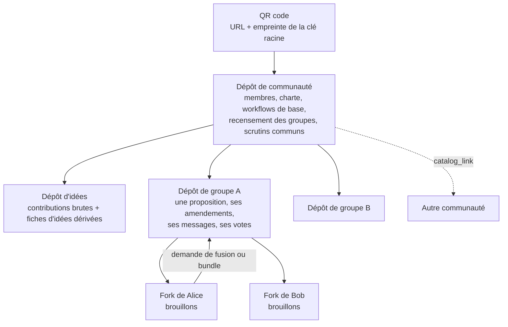
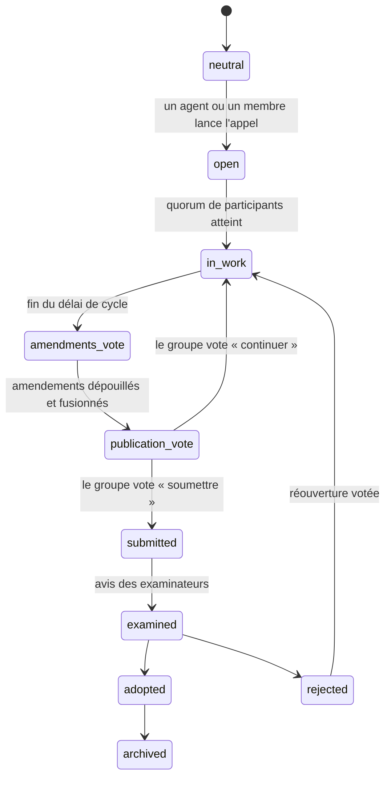
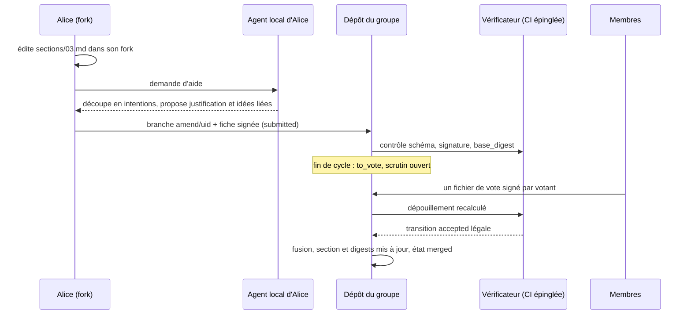
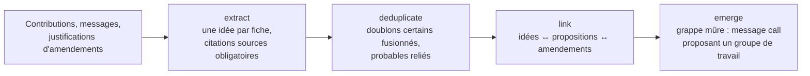

# KuneAgi V2 : délibération répartie sur Git, Markdown et frontmatter

> [!abstract] Intention
> Refaire KuneAgi (alias Nova-Ideo) **sans serveur central**. Tout ce que la plateforme stockait dans ZODB et pilotait par DaCE devient des fichiers Markdown dont le frontmatter porte le modèle de données, les états et les signatures. Chaque groupe de travail a son dépôt Git ; une communauté partage un dépôt qui recense ses groupes ; la messagerie, les amendements et les votes sont des fichiers signés ; les brouillons vivent dans des forks. La boîte à idées n'est plus tenue par des humains : des agents LLM extraient, dédoublonnent, fusionnent et relient les idées à partir des contributions.

> [!info] État de la note
> Première rédaction du 11 novembre 2026, à partir de la branche `V2` de Biblioteko (cahier des charges, ADR-001 à ADR-012, journal de conception), du cours [[Obsidian OSIA Construire son système d'exploitation personnel augmenté par l'IA|Obsidian OSIA]] et des notes [[Présentation Nova-Ideo]] et [[KuneAgi]]. L'inventaire fonctionnel de KuneAgi est fait de mémoire et d'après ces notes : il reste à confronter au code (`ecreall/nova-ideo`, `ecreall/KuneAgi`), en particulier les quorums. Les valeurs par défaut reprises de l'article de 2017 (douze participants par groupe, cinq groupes par membre, sept jetons, sept mentions, validation séquentielle) sont racontées dans [[présentation__kuneagi_v2]]. Rien n'est implémenté.

Voir aussi : [[git]], [[Markdown]], [[Obsidian]], [[LLM]], [[RAG]], [[Pyramid]].

# 1. D'où l'on part

## 1.1 Trois sources

| Source | Ce qu'elle apporte | Ce qu'on en garde |
| --- | --- | --- |
| **KuneAgi / Nova-Ideo** | Le *quoi* : idées, questions, propositions co-écrites par des groupes de travail, amendements justifiés, cycles d'amélioration, votes au jugement majoritaire, jetons de soutien, examen, modération, processus de citoyenneté | Tous les concepts et leurs règles ; rien de la pile (ZODB, DaCE, substanced, pontus) |
| **Biblioteko V2** | Le *comment réparti* : un dépôt Git par objet de travail, catalogue partagé par QR code, workflows déclaratifs avec état `neutral`, sections de frontmatter signées Ed25519, autorités locales au dépôt, vérification au commit par un vérificateur extérieur au dépôt, chiffrement `age` | Le socle entier, renommé `core` |
| **Obsidian OSIA** | Le *pourquoi* : Markdown mémoire durable, frontmatter modèle de données et mémoire d'état, emplacement qui ne porte pas l'état, transitions atomiques et idempotentes, fonctionnement sans IA, agent qui propose et système qui valide | Les principes et l'outillage agentique (domaines, skills, pipelines, habilitations) |

## 1.2 Position par rapport à ADR-012

L'ADR-012 de Biblioteko (encore *proposée*) recommande l'option C : garder `kuneagi-deliberation` comme paquet distinct pilotant des transitions signées. KuneAgi V2 tel que décrit ici est l'**option A** de ce même ADR, poussée à son terme : la délibération est réimplémentée en Markdown à frontmatter et ZODB disparaît. L'ADR lui opposait trois objections ; cette note doit y répondre, sinon elle ne vaut pas mieux que l'option écartée.

| Objection de l'ADR-012 à l'option A | Réponse de KuneAgi V2 |
| --- | --- |
| Réécrit des années de travail de Nova-Ideo | On ne réécrit pas 439 gabarits et 286 vues : on réécrit **24 paquets de processus** sous forme de définitions de workflow déclaratives (§5). L'interface devient un client sans état |
| Mécaniques riches (jugement majoritaire, jetons, citoyenneté) | Elles se ramènent à trois primitives : fichier signé, dépouillement déterministe rejouable, tirage au sort vérifiable (§7, §10) |
| La communauté KuneAgi perd son outil | Vrai tant qu'il n'existe pas de client utilisable par un non-informaticien. C'est le risque principal (§12) |

Conséquence : si cette piste est retenue, l'ADR-012 doit être révisée, pas contournée. La modernisation en cours de KuneAgi V1 (Python 3.12, Pyramid 2) reste utile pour maintenir le service pendant la transition.

# 2. Principes

1. **Aucun état hors des dépôts.** Un clone d'un dépôt de groupe contient le texte, les amendements, les messages, les votes, les résultats, les clés publiques et les scripts de vérification. Pas de base de données, pas de file de messages, pas de session.
2. **Un fichier, un objet, un `uid`.** Proposition, section, amendement, bulletin, message, membre : chacun est un fichier Markdown avec un ULID immuable. Ni le chemin ni un hachage Git n'identifient un objet à travers les forks.
3. **L'emplacement ne porte pas l'état.** Pas de dossier `à_voter` ou `acceptés`. L'état d'un amendement est `workflows.amendment.state`.
4. **Les décisions sont des transitions déclarées.** Accepter un amendement, publier une proposition, admettre un membre : ce sont des transitions d'un workflow lisible, dont la légalité est vérifiable par n'importe qui.
5. **La légitimité vient des signatures, pas de l'hébergement.** Le propriétaire d'un dépôt détient le bouton de fusion ; il ne détient pas la décision. Une transition collective n'est légale que si le dépouillement recalculé le confirme.
6. **Écriture sans conflit.** Tout ce qui est produit en parallèle par plusieurs personnes (messages, bulletins, soutiens) est un fichier par auteur et par acte, nommé par ULID : deux contributions simultanées ne touchent jamais le même fichier.
7. **Le droit de sortie est structurel.** Qui n'accepte pas une décision peut forker avec tout l'historique et toutes les preuves. Le fork est l'équivalent réparti de la scission.
8. **L'IA propose sur le dérivé, les humains décident sur le normatif.** Les idées, synthèses et traductions sont des objets dérivés, régénérables, sans poids décisionnel ; le texte de la proposition, les amendements et les votes sont humains et signés.
9. **Tout fonctionne sans IA, sans Obsidian et sans forge.** Sans IA, on perd la couche idées et les synthèses, pas la délibération. Sans forge, on échange des `git bundle`.
10. **Toute contribution est une donnée non fiable.** Un message, un amendement ou une idée n'est jamais une instruction pour un agent.

# 3. Topologie des dépôts



## 3.1 Le dépôt de communauté

C'est le **catalogue** de Biblioteko, élargi. Il recense les dépôts de groupes (une entrée Markdown par dépôt, avec ses miroirs et une copie dérivée de son état), et porte ce qui est commun :

```text
cosmopolitical--community/
├── _Community.md        notice : nom, charte, langues, règles chiffrées (taille des groupes,
│                        durées de cycle, quorums, méthode de vote par défaut), signée
├── members/             une fiche type: member par membre : pseudonyme, clés publiques
│                        (signature Ed25519, chiffrement X25519), état de citoyenneté
├── authorities/         clés des autorités et des agents, racine de confiance
├── groups/              une entrée type: catalog_entry par dépôt de groupe
├── ballots/             scrutins de niveau communauté (admissions, rôles, charte)
├── supports/            jetons de soutien et d'opposition aux propositions soumises
├── messages/            annonces et discussions générales
├── workflows/           définitions de base des workflows de délibération
├── agents/              fiches type: agent : mission, périmètres de lecture et d'écriture
├── schema.yaml          schéma unique du frontmatter
└── scripts/MANIFEST.yaml
```

Le QR code encode l'URL du dépôt et l'empreinte de la clé racine (`#fp=sha256:…`) : rejoindre une communauté, c'est scanner, cloner, vérifier. Les communautés se référencent entre elles par `catalog_link`, ce qui donne une fédération sans annuaire central.

## 3.2 Le dépôt de groupe de travail

Dans Nova-Ideo, un groupe de travail est lié à une proposition. On garde cette règle : **un groupe = une proposition = un dépôt**, nommé par un slug `<communauté>--<sujet>--<langue>`.

```text
cosmopolitical--revenu-universel--fr/
├── _Proposal.md         notice : titre, résumé, idées liées, liste ordonnée des sections
│                        avec leur content_digest, états de workflow, signatures
├── sections/            une section par fichier (l'équivalent des chapitres d'un livre)
├── amendments/          une fiche par amendement
├── ballots/<uid>/       _Ballot.md + votes/ un fichier par votant
├── messages/<année>/    un fichier par message
├── members/             participants du groupe et liste d'attente
├── digests/             synthèses dérivées produites par les agents
├── workflows/           surcharges locales éventuelles (sur-ensemble strict, ADR-010)
└── authorities/
```

Découper le texte en **sections** est ce qui rend l'amendement praticable : un amendement vise une ou quelques sections, deux amendements sur des sections différentes se fusionnent sans conflit, et l'empreinte de chaque section permet de dire sur quelle révision exacte on a voté.

## 3.3 Le dépôt d'idées

Un dépôt par communauté, à fort débit d'écriture, tenu par les agents (§9). Il contient les **contributions brutes** des membres (l'Inbox d'OSIA) et les **fiches d'idées** qui en sont dérivées.

## 3.4 Les forks : là où vivent les brouillons

Un brouillon n'entre jamais dans un dépôt partagé. L'état « brouillon » de Nova-Ideo devient un fait topologique : *le commit n'existe que dans mon fork*. Soumettre, c'est demander la fusion.

- Membre du groupe : branche `amend/<uid>` poussée dans le dépôt du groupe s'il est privé, fork sinon (règle Biblioteko : sur un dépôt public, seules les autorités poussent).
- Non-membre : fork et demande de fusion.
- Sans forge du tout : `git bundle` ou `git format-patch` transmis par n'importe quel canal (courriel, clé USB, messagerie). C'est le mode de repli qui garantit qu'aucune forge n'est un serveur central déguisé.

# 4. Les objets et leur frontmatter

Les clés partagées entre dépôts sont en anglais, comme dans Biblioteko (ADR-005) ; la prose est dans la langue du groupe.

| Type | Où | Rôle | Écrit par |
| --- | --- | --- | --- |
| `community` | communauté | Charte et paramètres | Autorités, sur décision votée |
| `member` | communauté, groupe | Identité pseudonyme, clés, citoyenneté | Le membre, contresigné |
| `agent` | communauté | Identité, mission et périmètre d'un agent LLM | Autorités |
| `catalog_entry` | communauté | Recensement d'un dépôt de groupe | Synchronisation |
| `contribution` | idées | Texte brut d'un membre : remarque, besoin, critique | Membre |
| `idea` | idées | Idée extraite, dédoublonnée, reliée | **Agent** |
| `question` | idées | Question et ses réponses | Membre ; regroupement par agent |
| `proposal` | groupe | Notice de la proposition | Groupe |
| `section` | groupe | Un morceau du texte | Groupe, par amendements |
| `amendment` | groupe | Intention de modification, justifiée | Membre |
| `ballot` | groupe, communauté | Définition d'un scrutin | Transition de workflow |
| `vote` | sous le scrutin | Bulletin d'un votant | Membre |
| `support` | communauté | Jeton de soutien ou d'opposition | Membre |
| `message` | partout | Commentaire, annonce, signalement, appel | Membre ou agent |
| `digest` | groupe | Synthèse d'un fil ou d'un cycle | **Agent** |
| `workflow` | communauté, groupe | Définition déclarative | Autorités |

Exemple d'amendement :

```yaml
---
schema_version: 1
uid: "01KB7M3QX2…"
type: amendment
proposal: "01KB6Z…"                       # uid de la proposition
author: "member:01KA9P…"                  # pseudonyme résolu dans members/
title: "Préciser le financement"
targets:                                  # sections visées et révision de départ
  - {section: "01KB70…", base_digest: "sha256:4a1e…"}
intention: "Remplacer la taxe unique par un panier de trois recettes."
justification: "La section 3 ne dit pas comment tenir en cas de récession."
ideas: ["01KB2C…", "01KB2F…"]             # rattachement proposé par l'agent, confirmé par l'auteur
branch: "amend/01KB7M3QX2"
head: "c0ffee…"                           # commit proposé ; le diff est celui de Git
conflicts_with: ["01KB7N…"]               # calculé : amendements touchant les mêmes passages
workflows:
  amendment: {state: to_vote, date: 2026-11-20}
signature: {envelope: 1, signer: "member:01KA9P…", covers: ["intention", "justification", "targets", "head"], digest: "sha256:…", value: "ed25519:…"}
---
Explication libre de l'amendement, lisible sans outil.
```

Le diff n'est pas recopié dans la fiche : il est dans Git, désigné par `head` et borné par `base_digest`. La fiche porte ce que Git ne sait pas dire : l'intention, la justification, le rattachement aux idées, l'état.

# 5. Les processus de Nova-Ideo en workflows déclaratifs

Chaque processus DaCE devient un document `type: workflow` : états, état `neutral`, transitions, rôles, signature requise, préconditions **structurées** (jamais d'expression évaluée). Un rôle nouveau apparaît, prévu par l'ADR-012 : `deliberation`. Une transition de rôle `deliberation` n'est déclenchée par personne en particulier ; elle est légale si un scrutin clos et dépouillé la justifie.

```yaml
transitions:
  - {from: to_vote, to: accepted, roles: [deliberation], signature: true,
     preconditions: [{ballot: amendments, state: tallied, outcome: accepted}]}
```

| Workflow | États | Qui fait bouger |
| --- | --- | --- |
| `membership` | neutral, applied, under_verification, member, suspended, resigned, excluded | Candidat, vérificateurs tirés au sort, `deliberation` |
| `idea` | neutral, extracted, merged, linked, dormant | Agent uniquement |
| `proposal` | neutral, open, in_work, amendments_vote, publication_vote, submitted, examined, adopted, rejected, archived | Groupe, `deliberation`, examinateurs |
| `amendment` | neutral, submitted, to_vote, accepted, rejected, withdrawn, merged | Auteur, `deliberation` |
| `ballot` | neutral, open, closed, tallied, void | Horloge déclarée, dépouillement signé |
| `moderation` | neutral, reported, under_jury, kept, hidden | Signaleur, jury tiré au sort |
| `archiving` | neutral, archived | `deliberation` |

Cycle de vie d'une proposition :



L'état `draft` de Nova-Ideo a disparu : c'est un fork (§3.4). Les états sont orthogonaux, comme dans Biblioteko : une proposition `in_work` peut avoir une section en `moderation: reported` sans que l'un ne bloque l'autre.

**Paramètres de cycle.** Le mode de travail et la durée du prochain cycle, que Nova-Ideo fait voter à chaque fin de cycle, sont des valeurs de la section `cycle` de la notice (`mode`, `opens`, `closes`), couvertes par la signature de la transition qui ouvre le cycle.

# 6. Co-écriture

Les trois modes de Nova-Ideo deviennent trois politiques de fusion sur les mêmes objets.

| Mode | Règle de fusion | Usage |
| --- | --- | --- |
| `wiki` | Tout participant fusionne directement une modification de section ; la vérification contrôle seulement le schéma, la signature de l'auteur et l'appartenance au groupe | Démarrage, texte encore informe |
| `amendment` | Aucune modification de section sans fiche d'amendement acceptée par scrutin | Texte disputé |
| `validation` | Séquentiel, une modification à la fois par section : un autre participant l'accepte, la refuse ou la corrige, par une fiche signée ; la fusion exige cette seconde signature | Relecture, orthographe, mise en forme |

Déroulé d'un amendement :



Trois règles reprises de Nova-Ideo et rendues vérifiables :

- **Un amendement, une intention.** L'agent local aide à découper un gros diff en amendements atomiques, mais c'est l'auteur qui signe chaque fiche.
- **Les amendements concurrents se votent ensemble.** Deux amendements dont les passages se recouvrent (`conflicts_with`, calculé par diff, pas par LLM) forment un seul scrutin au jugement majoritaire dont les candidats sont chaque version **et le texte d'origine**. On ne vote jamais « pour ou contre » un amendement isolé quand il a un rival.
- **On vote sur une révision, pas sur un titre.** Le scrutin référence le `head` de chaque amendement et le `base_digest` des sections ; si la base a bougé entre-temps, l'amendement doit être rebasé par son auteur et re-signé avant fusion, sinon il retombe en `submitted`.

# 7. Votes répartis

C'est le point le plus délicat du projet, et celui où il ne faut pas se raconter d'histoires.

## 7.1 Le scrutin et le bulletin

```yaml
---
type: ballot
uid: "01KB8A…"
subject: {kind: amendments, candidates: ["01KB7M…", "01KB7N…", "original"]}
method: majority_judgment            # majority_judgment | yes_no | approval | range
grades: [excellent, very_good, good, fairly_good, passable, insufficient, reject]   # les sept mentions de Nova-Ideo
electorate:                          # corps électoral gelé à l'ouverture
  members: ["member:01KA9P…", "…"]
  digest: "sha256:…"
quorum: 5
opens: 2026-11-20
closes: 2026-11-27
secrecy: public                      # public | commit_reveal | secret
workflows: {ballot: {state: open}}
---
```

Un bulletin est un fichier `ballots/<uid>/votes/<key_id>.md` dont le frontmatter porte les mentions et une enveloppe signée couvrant l'`uid` du scrutin et les choix : un bulletin copié vers un autre scrutin est invalide (mécanisme de l'ADR-004, inchangé). Un fichier par votant : aucune collision à la fusion.

## 7.2 Le dépouillement

`tally` est un script déterministe : il lit la définition du scrutin, écarte les bulletins hors corps électoral, mal signés ou hors délai, calcule le résultat et l'écrit dans la section `result` de `_Ballot.md`. Pour le jugement majoritaire, la règle de départage des mentions médianes égales doit être spécifiée au bit près (jauge majoritaire de Balinski et Laraki) et accompagnée de vecteurs de test : deux implémentations doivent produire le même octet.

Le résultat est une **signature collective** (`signatures: []`, annoncée par l'ADR-006) : au moins *k* membres rejouent le dépouillement et co-signent `result`. Le vérificateur de la forge le rejoue aussi. Personne n'a à être cru.

## 7.3 Le temps sans horloge commune

Une date signée est affirmée par le signataire ; elle ne prouve pas l'antériorité (limite déjà écrite dans Biblioteko). Pour clore un scrutin sans serveur d'horodatage :

1. la clôture est une transition signée `open → closed` qui fige la liste des bulletins reçus (`received_digest`) ;
2. un bulletin absent de cette liste est refusé, quelle que soit sa date ;
3. un membre dont le bulletin a été écarté à tort a un recours : son bulletin signé et l'historique de son fork sont des preuves publiables ; un scrutin contesté passe à `void` par décision d'un jury tiré au sort.

## 7.4 Le secret du vote

| Niveau | Mécanisme | Garantit | Ne garantit pas | Version |
| --- | --- | --- | --- | --- |
| `public` | Bulletin signé en clair | Vérifiabilité totale | Aucun secret | V2.0 |
| `commit_reveal` | Pendant le vote : `sha256(bulletin + aléa)` signé. Après clôture : révélation | Pas d'influence par les résultats partiels | Le secret après révélation ; un votant peut refuser de révéler (son bulletin est alors nul) | V2.0 |
| `secret` | Bulletins chiffrés pour une clé partagée entre scrutateurs tirés au sort, dépouillement vérifiable de type Belenios ; les fichiers de vote restent dans Git | Secret et vérifiabilité | La résistance à la coercition ; exige que les scrutateurs soient joignables | Plus tard, par ADR |

Le vote réellement secret sans tiers est un problème de recherche, pas un détail d'implémentation. La bonne attitude est de s'appuyer sur un protocole publié et audité (Belenios vient d'Inria et sait traiter le jugement majoritaire par mélange, à vérifier sur la version courante) et de ne stocker dans Git que ses bulletins et ses preuves. Le pseudonymat des membres (§10) réduit déjà l'enjeu des scrutins `public` internes à un groupe.

## 7.5 Jetons de soutien et d'opposition

Une proposition `submitted` reçoit des jetons : un fichier `supports/<proposal>/<key_id>.md` signé dans le dépôt de **communauté**, puisque le soutien engage tous les membres et pas le seul groupe. Retirer son jeton est un nouveau commit qui passe son état à `withdrawn`. Le plafond de Nova-Ideo (sept jetons par membre, que l'on déplace pour arbitrer) est écrit dans la charte et vérifié à la fusion dans le dépôt de communauté, qui est le seul endroit où tous les jetons d'un membre sont visibles.

# 8. Messagerie par Git

Un message est un fichier, pas une ligne dans une table :

```yaml
---
type: message
uid: "01KB9C…"
kind: comment                 # comment | announcement | report | objection | call | notice
from: "member:01KA9P…"
about: "01KB70…"              # uid de l'objet discuté ; ancre facultative dans le corps
in_reply_to: "01KB9A…"
signature: {…}
---
Je ne comprends pas le second paragraphe : qui paie la première année ?
```

- **Canaux.** Chaque contenu de Nova-Ideo avait son canal de discussion : c'est la requête « messages dont `about` vaut cet `uid` ». Aucun canal n'est créé ni stocké.
- **Sans conflit.** Les fichiers sont nommés par ULID dans `messages/<année>/` ; l'ordre d'affichage est celui des ULID, départagé par `in_reply_to`.
- **Notifications.** Elles ne sont pas stockées : c'est un état dérivé. Le client calcule, depuis mon dernier `fetch`, les objets nouveaux ou modifiés qui me concernent (je suis auteur, participant, cité, ou abonné par ma fiche de membre). Une forge qui envoie des courriels ou expose un flux est un accélérateur, pas une dépendance.
- **Messages privés.** Fichier chiffré `age` pour les clés X25519 des destinataires (ADR-009), déposé dans un dépôt privé partagé entre les interlocuteurs ou dans le dépôt du groupe. Le dépôt ne révèle que l'existence et la taille du message.
- **Modération.** Un signalement est un message `kind: report`. Masquer est un état signé (`workflows.moderation.state: hidden`) décidé par un jury ; le client n'affiche plus le texte, qui reste dans l'historique. On ne promet pas l'effacement.
- **Délai.** La messagerie est asynchrone, au rythme des `pull`. KuneAgi V2 n'est pas un chat et ne doit pas faire semblant de l'être.

# 9. Les idées, tenues par des agents LLM

## 9.1 Ce qui change

Dans Nova-Ideo, des humains créent les idées, les modèrent, les comparent, repèrent les doublons, les rattachent aux propositions. C'est le travail le plus ingrat de la plateforme et celui qui passe le plus mal à l'échelle ; la fusion idée/proposition envisagée en 2021 avec CamemBERT n'a jamais abouti. En V2, **aucun humain ne crée ni ne gère une fiche d'idée**.

Les membres écrivent ce qu'ils ont à dire, où ils le disent déjà : contributions libres dans le dépôt d'idées, messages, justifications d'amendements. Un agent **curateur** en tire les idées.



## 9.2 Pourquoi c'est acceptable sans validation humaine

OSIA pose que l'IA propose et que l'humain valide. On ne viole pas la règle, on déplace la frontière : la fiche d'idée devient un **objet dérivé**, comme un index.

- Elle est **régénérable** : supprimer `ideas/` et rejouer le pipeline sur les contributions redonne un ensemble équivalent.
- Elle est **sans poids décisionnel** : aucune transition de workflow n'a une idée pour précondition ; on ne vote pas sur une idée, on vote sur un amendement ou une proposition.
- Elle est **traçable** : chaque fiche cite les `uid` et les passages des contributions dont elle est tirée (`sources:`), et porte `provenance.generation` (modèle, version, empreinte du prompt, date) et `metadata_verified: false` à vie.
- Elle est **contestable** : un membre qui se juge mal résumé ou fusionné à tort écrit un message `about:` la fiche ; ce message est une contribution comme une autre, que le pipeline relit.

Ce qui reste strictement humain : le texte normatif, les amendements, les votes, les admissions.

## 9.3 Les agents

Chaque agent est une fiche `type: agent` dans le dépôt de communauté, avec sa clé, sa mission, ses périmètres de lecture et d'écriture (moindre privilège) et les workflows qu'il a le droit de faire bouger.

| Agent | Lit | Écrit | Ne fait jamais |
| --- | --- | --- | --- |
| **Curateur d'idées** | Contributions, messages, amendements | `ideas/` du dépôt d'idées, messages `call` | Toucher une section, un scrutin, une fiche de membre |
| **Assistant d'amendement** (local, chez le membre) | Le fork du membre | Rien dans les dépôts partagés : il propose, le membre signe | Signer à la place du membre |
| **Synthétiseur** | Messages et amendements d'un cycle | `digests/` | Arbitrer, recommander un vote |
| **Traducteur** | Sections, messages | Fichiers dérivés par langue, avec l'empreinte de la source traduite | Faire foi : seule la langue du groupe fait foi |
| **Veilleur de modération** | Messages | Messages `report` | Masquer : seul un jury masque |

Le calcul des conflits entre amendements, le dépouillement, le tirage au sort et la vérification des signatures ne sont **pas** confiés à un LLM : ce sont des commandes déterministes. On ne donne au modèle que ce qui est irréductiblement linguistique.

## 9.4 Qui fait tourner le modèle, sans serveur central

Le pipeline est un ensemble de Skills OSIA rejouables ; n'importe quel membre peut l'exécuter chez lui avec le modèle de son choix. Pour que la communauté partage **une** vue des idées, une instance est désignée : la fiche d'agent nomme un exécutant (un membre volontaire, ou la tâche planifiée d'une forge) et sa clé. Ses écritures arrivent comme des demandes de fusion ordinaires, vérifiées comme celles d'un humain, dans son seul périmètre. Tout membre peut rejouer le pipeline et publier l'écart comme preuve d'une dérive. Changer d'exécutant ou de modèle est une décision votée, pas une migration.

## 9.5 Sécurité

Toute contribution est un vecteur d'injection. Les règles du chapitre 23 d'OSIA s'appliquent telles quelles : le texte lu est une donnée, jamais une consigne ; l'agent n'a aucun accès en écriture hors de son périmètre ; il ne détient aucune clé humaine ; ses écritures passent par le même vérificateur que les autres ; un contenu qui cherche à le commander est signalé, pas exécuté.

# 10. Gouvernance et confiance

- **Autorités.** Comme dans Biblioteko, est autorité qui possède le dépôt et peut fusionner. Mais le vérificateur, hébergé hors du dépôt et épinglé, refuse toute fusion qui ne découle pas d'une transition légale. L'autorité est un greffier : elle exécute, elle ne décide pas. Les autorités sont désignées et révoquées par scrutin de la communauté.
- **Citoyenneté.** Le processus de KuneAgi (repris par AlirPunkto : candidature, vérification d'identité par des membres tirés au sort, vote d'admission) devient le workflow `membership`. La fiche de membre publie un **pseudonyme** et des clés, jamais l'identité civile ; les vérificateurs signent « j'ai vérifié », pas ce qu'ils ont vu. C'est la protection contre les comptes multiples, sans laquelle aucun vote n'a de sens.
- **Tirage au sort vérifiable.** Vérificateurs, jurys de modération et scrutateurs sont tirés sans serveur : la graine est une valeur publique imprévisible à l'avance (balise aléatoire publique, ou engagements croisés de plusieurs membres révélés ensuite) ; le rang de chaque membre est `sha256(graine + uid)` ; les premiers sont désignés. Chacun peut refaire le calcul.
- **Rôles.** *Examiner* et *Moderator* de Nova-Ideo ne sont plus des comptes privilégiés mais des rôles déclarés dans les fiches de membres, attribués par scrutin, vérifiés par le rôle exigé dans chaque transition.
- **Racine et révocation.** Inchangées par rapport à Biblioteko : racine amorcée par le QR code, changement de racine signé par la précédente, fiche révoquée conservée avec sa date.

# 11. Correspondance KuneAgi V1 → V2

| Concept KuneAgi / Nova-Ideo | V1 (ZODB, DaCE) | V2 répartie |
| --- | --- | --- |
| Instance de la plateforme | Un serveur, un `Data.fs` | Un dépôt de communauté et son QR code |
| Compte utilisateur | Objet `Person`, LDAP | Fiche `member` pseudonyme et paire de clés |
| Inscription vérifiée | Processus de citoyenneté | Workflow `membership`, vérificateurs tirés au sort |
| Idée | Contenu créé et modéré par des humains | Fiche dérivée tenue par l'agent curateur |
| Question et réponses | Contenus dédiés | Contributions `question` et messages `in_reply_to` |
| Appel à idées (*challenge*) | Contenu `challenge` | Message `call` et thème de collecte dans le dépôt d'idées |
| Proposition | Contenu avec états DaCE | Dépôt de groupe, `_Proposal.md`, `sections/` |
| Groupe de travail | Objet lié à la proposition, liste d'attente | `members/` du dépôt de groupe, droits de la forge |
| Brouillon | État `draft` | Commits dans un fork |
| Mode wiki, amendement, validation | Branches du processus | Politique de fusion déclarée dans `cycle.mode` |
| Amendement | Objet avec explications par modification | Branche et fiche `amendment` signée |
| Cycle d'amélioration | Minuterie DaCE | `cycle.opens`, `cycle.closes`, transition de clôture signée |
| Vote au jugement majoritaire | Objets `ballot` | Fichiers de vote signés, dépouillement rejouable |
| Jeton de soutien, d'opposition | Objet `token` | Fichier `support` signé dans le dépôt de communauté |
| Examen | Rôle *Examiner* | Transition `submitted → examined` signée par un rôle élu |
| Signalement, modération | Rôle *Moderator* | Message `report`, jury tiré au sort, état `hidden` |
| Canal de discussion | Objets `channel`, `comment` | Requête sur `about:` |
| Alertes et courriels | Générés par le serveur | État dérivé calculé par le client |
| Recherche, dossiers intelligents | Catalogue hypatia | Index local reconstruit depuis les frontmatters, vues Obsidian |
| Moteur de workflow | DaCE | Définitions `type: workflow` et scripts de transition atomiques |
| Interface | Pontus, Chameleon | Obsidian, CLI, portail sans état, client mobile à faire |

# 12. Ce qu'on gagne, ce qu'on perd

**On gagne** : plus de serveur à maintenir ni de socle orphelin (substanced, hypatia, le moteur d'événements de DaCE) ; un historique complet et signé de chaque décision ; le travail hors ligne ; le droit de scission ; l'indépendance vis-à-vis du modèle d'IA et de la forge ; une communauté qui survit à son hébergeur.

**On perd ou on risque** :

- **L'accessibilité.** Git, les clés et les forks sont hors de portée de la plupart des citoyens. Sans client qui cache entièrement Git (application mobile ou portail sans état qui clone, signe localement et pousse), le projet reste un outil d'informaticiens. C'est le risque qui peut tout annuler.
- **La garde des clés.** Perdre sa clé, c'est perdre son identité de membre. Il faut une procédure de ré-admission par les pairs, donc un point d'attaque sociale.
- **Le temps réel.** Asynchrone par construction.
- **Le secret du vote.** Partiel en V2.0 (§7.4).
- **L'effacement.** Un historique signé et cloné ne s'efface pas. Le pseudonymat et l'absence de donnée d'identité dans les dépôts sont la seule réponse sérieuse au RGPD ; elle doit être validée juridiquement avant tout déploiement.
- **Le contrôle d'accès.** Un dépôt privé dépend des droits d'une forge. « Sans serveur central » veut dire « sans serveur applicatif et sans forge imposée », pas « sans infrastructure ».
- **L'échelle.** Des centaines de dépôts de groupes et des milliers de petits fichiers de messages : l'index local et la synchronisation sélective sont à concevoir.
- **La dérive des agents.** Deux modèles ne produisent pas les mêmes fiches d'idées. Acceptable seulement parce que les idées sont dérivées et sans poids (§9.2) ; le jour où l'on voudra voter sur une idée, tout le raisonnement tombe.

# 13. Feuille de route proposée

| Phase | Contenu | Dépend de |
| --- | --- | --- |
| 0 | Biblioteko V2 : schéma, workflows, signatures, catalogue (tâches 002 et 003 en cours) | — |
| 1 | `signatures: []`, rôle `deliberation`, préconditions sur scrutin ; révision de l'ADR-012 | 0 |
| 2 | Dépôt de groupe minimal : sections, amendements, mode `amendment`, scrutin `public` au jugement majoritaire, `tally` avec vecteurs de test | 1 |
| 3 | Messagerie par fichiers, notifications dérivées, dépôt de communauté, `membership` | 2 |
| 4 | Dépôt d'idées et agent curateur ; assistant d'amendement local | 3 |
| 5 | Client grand public ; import d'une instance KuneAgi V1 (export ZODB vers dépôts) | 2 à 4 |
| 6 | Vote secret, tirage au sort vérifiable, jurys | 3 |

La phase 2 est l'expérience décisive : un groupe réel qui amende un texte réel et vote, à la main et en ligne de commande. Si cela ne tient pas à cinq personnes, rien de la suite ne mérite d'être construit.

# 14. Questions ouvertes

1. **Nom.** « KuneAgi V2 » convient-il au projet fusionné, ou est-ce le nom de la seule couche de délibération posée sur le socle de Biblioteko ?
2. **ADR-012.** Assume-t-on de passer de l'option C à l'option A, et que devient la modernisation de KuneAgi V1 ?
3. **Une proposition par dépôt**, ou un groupe peut-il porter plusieurs propositions liées ?
4. **Idées sans aucun humain** : accepte-t-on qu'un membre ne puisse plus « déposer une idée » comme objet de premier rang, mais seulement une contribution ?
5. **Jetons** : plafond par membre, et que valent-ils si la communauté se scinde ?
6. **Vote secret** : quel protocole, et à partir de quelle taille de communauté est-il exigible ?
7. **Exécutant des agents** : membre volontaire, tâche de forge, ou plusieurs exécutants dont on compare les sorties ?
8. **RGPD** : le pseudonymat suffit-il face au droit à l'effacement ?
9. **Client** : extension d'Obsidian, portail Pyramid sans état avec îlots SolidJS (ADR-011), ou application mobile d'abord ?
10. **Langue des clés** : anglais comme Biblioteko pour les dépôts partagés, alors que ce coffre est en français.

# 15. Sources

- Biblioteko, branche `V2` : `docs/fr/Cahier des charges.md`, `docs/fr/Journal de conception.md`, ADR-002, ADR-003, ADR-004, ADR-006, ADR-009, ADR-010, ADR-012.
- [[Obsidian OSIA Construire son système d'exploitation personnel augmenté par l'IA|Cours Obsidian OSIA]], chapitres 2, 10, 16, 17, 20, 21 et 23.
- [[Présentation Nova-Ideo]] ; audit et plan de modernisation de Nova-Ideo du 13 juillet 2026.
- Thèse d'Amen Souissi (2013) : <https://hal.science/tel-00935324v1>
- Dépôts Nova-Ideo, KuneAgi, dace et pontus : <https://github.com/ecreall>
- Belenios, vote électronique vérifiable : <https://www.belenios.org/>
