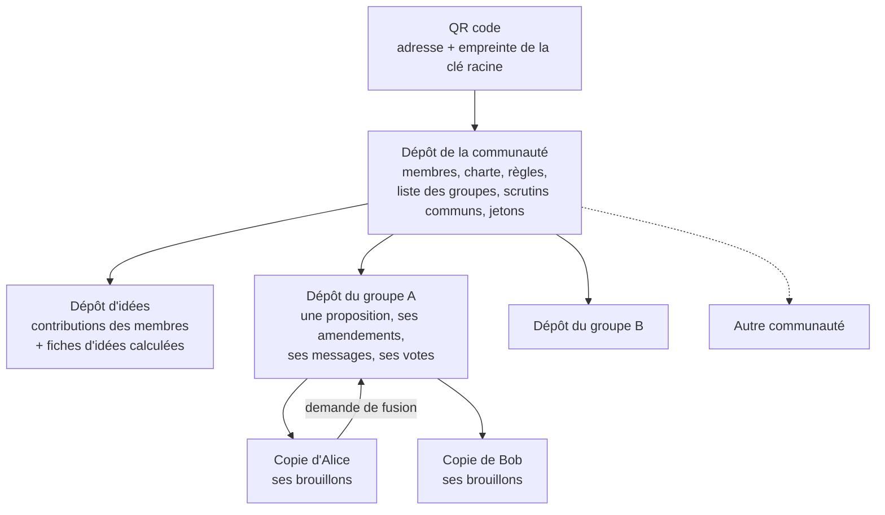

# KuneAgi V2, l'innovation participative répartie

> [!warning] Texte d'anticipation
> Cet article décrit KuneAgi V2 **comme s'il fonctionnait entièrement**. Ce n'est pas le cas : au 12 novembre 2026 rien n'est implémenté. Les écrans sont des croquis, les chiffres d'usage et les noms de membres sont inventés. Le but est de vérifier que le projet est compréhensible à un lecteur non informaticien avant de le construire.

> [!info] Comment lire ce document
> Il se suffit à lui-même. L'**avant-propos** dit d'où vient le projet : le logiciel Nova-Ideo, l'article de 2017 que ce texte réécrit, et les deux travaux récents dont il réutilise les idées, Biblioteko et OSIA. Les **sections 1 à 6** sont l'article proprement dit, écrit du point de vue de l'utilisateur. La **section 7** ouvre le capot pour qui veut savoir comment cela peut tenir sans serveur. La **section 8** dit ce qui ne marche pas encore ou ne marchera jamais. Un **glossaire** et les **références** terminent le document. Les mots en italique suivis d'un astérisque à leur première apparition (*dépôt*\*, *fork*\*…) sont au glossaire.

# Avant-propos : d'où vient KuneAgi V2

## A. Nova-Ideo et KuneAgi (2013-2026)

En 2013, Amen Souissi soutient à l'Université Lille 1 une thèse préparée au sein d'Ecréall, la société de services en logiciels libres que j'avais fondée : *Modélisation centrée sur les processus métier pour la génération complète de portails collaboratifs* [1]. L'idée est de décrire formellement les processus d'une organisation (qui fait quoi, dans quel ordre, à quelle condition) puis de **générer** tout le portail à partir de cette description. La preuve de concept est une boîte à idées collaborative, baptisée **KuneAgi**, « agir ensemble » en espéranto.

Réécrite à la main et généralisée, cette boîte à idées devient en 2014 **Nova-Ideo**, un logiciel libre (licence AGPL v3) d'innovation et de démocratie participatives [2]. Il est écrit en Python avec le cadriciel web Pyramid ; ses données vivent dans une base de données objet (ZODB) et ses processus sont exécutés par un moteur maison issu de la thèse (DaCE). Nova-Ideo est retenu en 2016 par Etalab pour la boîte à outils du Partenariat pour un gouvernement ouvert [3], et déployé pour plusieurs organisations. Le nom KuneAgi reste celui de l'instance de la coopérative Cosmopolitical [4], qui s'en sert pour délibérer et y a fait ajouter ses propres règles : scrutins, vérification de l'identité des membres par leurs pairs.

Ecréall cesse son activité en 2023. Le code est repris en 2024 par Logikascium, l'EURL que j'ai fondée et par laquelle j'exerce comme indépendant, sous le nom KuneAgi. Il fonctionne, mais sur un socle technique figé en 2017 dont plusieurs briques ne sont plus maintenues par personne, et sa modernisation est engagée depuis 2025.

## B. L'article de 2017

Le 5 mars 2017, j'ai publié *Nova-Ideo, l'innovation participative agile* [5], une présentation détaillée du logiciel pour un public d'informaticiens. Le présent document en reprend le plan, section par section. Voici ce qu'il disait, pour qui ne l'a pas lu.

- **Le constat.** Les outils de consultation font voter et commenter la foule ; ils suscitent de l'enthousiasme puis croulent sous le nombre d'idées. Nova-Ideo veut faire *réfléchir* la foule, pas seulement la compter.
- **L'idée est personnelle, la proposition est collective.** On s'identifie à son idée : la critiquer, c'est critiquer son auteur. Une idée n'a donc qu'un auteur et ne se modifie plus une fois publiée ; on peut seulement la dupliquer. Une proposition, elle, est écrite à plusieurs.
- **De petits groupes.** Au-delà d'une douzaine de personnes on ne se connaît plus assez pour travailler en confiance. Un groupe de travail est limité à 12 participants, et un membre à 5 groupes. Mieux vaut plusieurs petits groupes en concurrence qu'un grand.
- **Des itérations courtes.** Le groupe travaille par cycles à durée limitée. À la fin de chaque cycle il vote : publier, ou continuer ; et dans ce cas, pour combien de temps et selon quel mode.
- **Trois modes de co-écriture.** *Wiki* : chacun modifie, sans validation. *Validation* : chaque modification est relue par un autre. *Amendements* : chacun modifie de son côté, regroupe ses modifications par intention, les justifie, et le groupe vote.
- **Le jugement majoritaire.** Les amendements concurrents sont départagés par ce mode de scrutin [6] : on ne choisit pas un candidat, on donne une mention à chacun, et la meilleure mention médiane l'emporte.
- **Des jetons rares.** Chaque membre dispose de 7 jetons pour soutenir ou rejeter ce qui est publié. Quand il n'en a plus, il doit en reprendre un : il arbitre.
- **Des comités.** Un comité de pilotage se prononce sur les propositions et publie son avis sous la forme d'un feu tricolore.

Tout cela reste juste, et KuneAgi V2 le garde. Ce que l'article ne disait pas, parce que cela allait de soi à l'époque : Nova-Ideo est **un serveur**. Quelqu'un l'héberge, l'administre, détient la base de données, la liste des membres et les bulletins de vote. Et le tri des idées (lire, rapprocher, dédoublonner) reste un travail humain qui ne passe pas à l'échelle.

## C. Deux travaux de 2026 dont KuneAgi V2 réutilise les idées

**Biblioteko** [7] est un projet de bibliothèque numérique libre et décentralisée, pour une association qui numérise des livres et les prête. Sa version 2, spécifiée en novembre 2026 et pas encore développée, repose sur quelques décisions qui n'ont rien de propre aux livres :

- un livre est un ensemble de fichiers texte ordinaires, lisibles sans logiciel particulier ;
- chaque livre a son propre *dépôt*\*, que n'importe qui peut copier et modifier de son côté ;
- les membres s'échangent des **catalogues**, c'est-à-dire des listes de dépôts, par un simple QR code ;
- l'état d'un livre (à vérifier, publié, prêté) est écrit **dans le fichier lui-même**, dans son en-tête, et non dans une base de données ;
- les décisions importantes sont **signées** numériquement par ceux qui les prennent, et chacun peut vérifier ces signatures chez soi, sans réseau.

Remplacez « livre » par « proposition » et « bibliothécaire » par « groupe de travail » : c'est une plateforme de délibération sans serveur.

**OSIA** (*Obsidian Operating System IA*) [8] est une méthode que j'enseigne pour tenir un système d'information personnel dans de simples fichiers texte, assisté par des intelligences artificielles. Trois de ses règles servent ici :

- le fichier texte est la mémoire durable ; son en-tête structuré est à la fois la fiche descriptive et la mémoire d'état ;
- l'emplacement d'un fichier ne dit rien de son état : on ne déplace pas un document de « à valider » vers « validé », on change une ligne de son en-tête ;
- l'IA **propose**, le système **vérifie**, l'humain **décide** ; et tout doit continuer à fonctionner sans IA.

## D. L'idée de KuneAgi V2

Garder de Nova-Ideo tout ce qui concerne les personnes (les petits groupes, les itérations, les amendements, le jugement majoritaire, les jetons) et remplacer tout ce qui concerne la machine. Plus de serveur : des dépôts de fichiers que les membres se partagent. Plus de base de données : l'état est dans les fichiers. Plus d'administrateur à croire sur parole : des signatures que chacun vérifie. Plus de tri manuel des idées : des agents d'IA qui rangent, sans jamais décider.

***En 2017, j'écrivais que la plupart des outils de la « CivicTech » faisaient travailler la foule, et que Nova-Ideo voulait la faire réfléchir. Neuf ans plus tard l'ambition est la même, mais il n'y a plus de plateforme : ni serveur, ni base de données, ni administrateur. Il reste des textes, des signatures, et des gens qui se mettent d'accord.***

# 1. Participatif ?

Le constat de 2017 tient toujours. Qu'on parle de démocratie participative ou d'innovation participative, on demande leur avis à des personnes en les faisant voter ou commenter, et l'écueil est le même : susciter de l'enthousiasme puis ne pas savoir répondre au trop grand nombre d'idées et de commentaires.

Deux choses ont changé depuis.

La première est la confiance. Une consultation hébergée par celui qui la commande reste, pour beaucoup de participants, de la communication : qui tient le serveur tient la liste des votants, l'ordre d'affichage et le bouton de suppression. KuneAgi V2 retire le serveur. Chaque membre détient une copie complète et signée de tout ce qui a été écrit et voté ; personne ne peut réécrire l'histoire sans que cela se voie, et un groupe en désaccord peut partir avec toutes les pièces.

La seconde est le tri. Le travail qui épuisait les animateurs de Nova-Ideo (lire toutes les idées, repérer les doublons, les regrouper, les rattacher aux propositions) est fait par des modèles de langage. Ils ne décident de rien : ils rangent.

Le reste est inchangé. KuneAgi V2 organise la récolte de contributions, la co-écriture de propositions d'action par de petits groupes, des appels à idées pour répondre à une problématique, et le soutien ou le rejet de ce qui est publié. Sa force reste la *coopétition* des cycles itératifs du logiciel libre, dont il emprunte cette fois aussi les outils : *Git*\*, les *forks*\*, les *demandes de fusion*\*.

# 2. Rejoindre plutôt qu'installer

En 2017, il fallait installer Nova-Ideo par Docker ou s'abonner au service en ligne. Il n'y a plus rien à installer côté communauté, puisqu'il n'y a plus de côté communauté : une communauté est un dépôt de fichiers qui recense les dépôts de ses groupes de travail, et que l'on rejoint en scannant un QR code.

![[réflexions/réflexions_images/kuneagi_v2_croquis_01_rejoindre.excalidraw]]

*Croquis 1 (mobile) : rejoindre une communauté. On scanne, l'application vérifie l'empreinte de la clé racine, crée les clés du membre et dépose la candidature.*

L'admission reprend le processus de citoyenneté de KuneAgi : des membres tirés au sort vérifient que le candidat est une personne réelle et qu'il n'a pas déjà un compte, puis signent. La communauté ne connaît qu'un pseudonyme et des clés publiques.

Trois façons d'utiliser KuneAgi V2 coexistent, sur les mêmes fichiers :

- l'**application mobile**, pour contribuer, discuter, voter ; elle cache entièrement Git et les clés ;
- le **poste de travail**, pour écrire longuement et préparer des amendements : l'éditeur de notes Obsidian [9] ou le portail local, qui n'est qu'une vue sur les dépôts clonés ;
- la **ligne de commande**, pour vérifier, dépouiller, automatiser. Tout ce que font les deux autres passe par elle.

Les dépôts sont hébergés où la communauté le souhaite, sur au moins deux *forges*\*. Aucune n'est indispensable : deux membres peuvent s'échanger un groupe de travail entier par clé USB.

# 3. Première utilisation : dire quelque chose

En 2017, on créait une idée ou une question : titre, texte, mots-clés, pièces jointes, puis publication. Aujourd'hui on écrit ce qu'on a à dire, et c'est tout.

![[réflexions/réflexions_images/kuneagi_v2_croquis_02_contribuer.excalidraw]]

*Croquis 2 (mobile) : la contribution remplace le formulaire de création d'idée de 2017. On écrit, on publie ; le brouillon reste dans sa copie personnelle.*

Le membre ne saisit ni titre ni mots-clés et ne choisit pas si son texte est « une idée ». Il indique seulement s'il fait une remarque ou pose une question, et éventuellement à quel appel il répond. Pour une question, il peut comme avant proposer des choix de réponse ; chaque répondant sélectionne le sien et l'argumente, et les réponses libres sont affichées par ordre de soutien.

Tout cela est fluide, et comme en 2017 chaque geste engage la nature du travail. La différence est que l'engagement est visible : publier, c'est signer.

![[réflexions/réflexions_images/kuneagi_v2_croquis_03_accueil.excalidraw]]

*Croquis 3 (PC) : l'accueil. Les appels à idées en tête, mes groupes, puis les idées calculées et les propositions, triées et filtrées. Les flèches sont les jetons de soutien et d'opposition.*

# 4. Problématique

## 4.1 La contribution est personnelle, l'idée est calculée, la proposition est collective

Les gens s'identifient à leur idée : la critiquer revient souvent à critiquer son auteur. Nova-Ideo y répondait en faisant de l'idée un document à auteur unique, figé à la publication, que l'on pouvait seulement dupliquer. C'était juste, mais cela produisait des dizaines d'idées voisines que personne ne rapprochait, et des auteurs vexés de voir « leur » idée oubliée au profit d'un doublon mieux placé.

KuneAgi V2 sépare trois objets.

- La **contribution** est personnelle, signée, et ne change plus une fois publiée. C'est ce que j'ai dit.
- L'**idée** n'appartient à personne. C'est une fiche rédigée par un agent, le *curateur*, à partir de toutes les contributions qui disent la même chose. Elle cite ses sources, mot pour mot, et nomme leurs auteurs.
- La **proposition** est collective : c'est le texte qu'un groupe de travail co-écrit à partir d'une ou plusieurs idées.

![[réflexions/réflexions_images/kuneagi_v2_croquis_04_idee.excalidraw]]

*Croquis 4 (mobile) : une fiche d'idée cite toujours les contributions dont elle est tirée. L'auteur mal compris le dit ; il ne corrige pas la fiche, il ajoute une contribution.*

Le déplacement est psychologique autant que technique. Je ne défends plus *mon* idée contre celle du voisin : je retrouve ma phrase citée à côté de la sienne dans une fiche qui ne porte le nom d'aucun de nous. Et si le curateur m'a mal compris, je le dis, ce qui ajoute une contribution au lieu d'ouvrir une querelle.

Une fiche d'idée n'a aucun pouvoir. On ne vote pas sur elle, aucune décision n'en dépend, et la communauté pourrait effacer toutes les fiches et les faire recalculer par un autre modèle sans rien perdre : les contributions sont intactes. C'est ce qui rend acceptable de la confier à une machine.

## 4.2 Le fork des contenus

En 2017, « fork » était une métaphore empruntée au logiciel libre. C'est maintenant le mécanisme lui-même.

Dupliquer une proposition, c'est copier le dépôt du groupe : texte, historique, amendements, votes, tout vient avec, et la paternité de chaque phrase reste inscrite. Un nouveau groupe peut repartir du travail d'un autre, quel que soit son état. Le travail n'est jamais perdu, et il est malléable à souhait.

Le fork a pris deux autres rôles.

- **Le brouillon.** Tout ce que je n'ai pas encore soumis vit dans ma copie personnelle. Il n'y a plus de bouton « enregistrer sans publier » : il y a ma copie, et le dépôt commun.
- **Le désaccord.** Un groupe qui se divise ne se bloque pas : une partie poursuit dans une copie, et les deux propositions concurrentes seront soumises au soutien de tous. C'est exactement « plusieurs petits groupes en concurrence sur le même sujet », que je recommandais en 2017 sans avoir l'outil pour.

L'historique des versions n'est plus une fonction : c'est Git.

## 4.3 Les cartes des contenus

Nova-Ideo traçait les duplications et les réutilisations et permettait de naviguer dans le graphe des parentés. La carte existe toujours, et elle est plus riche parce qu'elle ne dépend plus de ce que les gens ont pensé à déclarer.

![[réflexions/réflexions_images/kuneagi_v2_croquis_05_carte.excalidraw]]

*Croquis 5 (PC) : la carte des contenus. Les liens de parenté ne sont plus saisis : ils sont lus dans les frontmatters et dans l'historique des dépôts.*

Chaque fichier dit dans son en-tête (son *frontmatter*\*) de quoi il est tiré, à quoi il répond, ce qu'il amende. Sur le poste de travail, la vue graphe d'Obsidian affiche cette carte sans rien développer.

## 4.4 Les appels à idées

Les *challenges* de 2017 s'appellent des appels. Ils structurent l'accueil, regroupent les contributions par thème, peuvent être ouverts à tous ou restreints à une partie des membres, et portent une échéance au-delà de laquelle on ne contribue plus.

La coopétition joue comme avant : chacun voit ce que les autres ont proposé et peut surenchérir, améliorer, ou rejoindre un groupe de travail né de l'appel. Mais on ne la voit plus sous la forme d'une liste de cent idées dont trente sont la même : on voit douze idées, chacune avec le nombre de voix qui la portent.

Le curateur a un rôle de plus. Quand une idée a reçu assez de contributions d'auteurs différents, il la signale comme mûre et propose l'ouverture d'un groupe de travail. Il propose ; un membre lance.

![[réflexions/réflexions_images/kuneagi_v2_croquis_06_appel.excalidraw]]

*Croquis 6 (mobile) : à gauche un appel à idées, à droite l'entrée dans un groupe de travail. Quand le groupe est plein, le bouton devient « M'inscrire sur la liste d'attente ».*

## 4.5 Le travail en groupe

L'homme a un comportement essentiellement coopératif. Il forme des groupes pour résoudre des problèmes, et la communication devient alors l'activité principale : plus le groupe échange, plus il a de chances d'aboutir ; plus les profils sont complémentaires, meilleures sont les solutions. Si les cultures diffèrent il faut du temps pour se comprendre, et si les convictions s'opposent il faut orchestrer le débat pour en tirer la richesse plutôt que le règlement de comptes.

Nova-Ideo orchestrait par un processus métier paramétrable, « en attendant d'avoir un éditeur de processus intégré ». Cet éditeur n'a jamais existé et n'est plus nécessaire : un processus est un document. La définition des étapes d'une proposition (qui peut faire passer de quel état à quel autre, avec quelle signature, à quelle condition) est un fichier lisible, placé dans le dépôt de la communauté, que celle-ci modifie par un vote comme n'importe quel texte.

Un groupe de travail naît d'une idée mûre. Il reçoit un dépôt et une proposition dont le résumé reprend l'idée de départ. Le texte est découpé en sections, selon un modèle de document que la communauté peut imposer.

![[réflexions/réflexions_images/kuneagi_v2_croquis_07_proposition.excalidraw]]

*Croquis 7 (PC) : la proposition, découpée en sections. À gauche l'état de l'itération ; à droite le texte, son fil de discussion et la synthèse, toujours signalée comme écrite par une machine.*

## 4.6 La taille de groupe optimale

Rien à retirer à ce que j'écrivais. Dès qu'un groupe dépasse la dizaine de personnes, ses participants ne se connaissent plus assez pour être en confiance, donc spontanés et efficaces. Certains se mettent en retrait, et le nombre de discussions avant action explose. Il faut dépasser la centaine pour retrouver, par le nombre, l'efficacité d'un groupe de moins de douze ; et un grand groupe qui cherche à s'organiser aboutit le plus souvent à une pyramide qui étouffe les idées de sa base.

La solution reste d'avoir plusieurs petits groupes en concurrence sur le même sujet, quitte à ce qu'un autre fusionne leurs propositions.

KuneAgi V2 garde donc les valeurs par défaut : **douze participants** par groupe, **cinq groupes** par membre, une liste d'attente au-delà. Ces nombres sont écrits dans la charte de la communauté et se changent par un vote.

Ce qui est nouveau, c'est que la règle du petit groupe est devenue une propriété de l'architecture. Un groupe est un dépôt : douze personnes qui écrivent dans le même dépôt s'entendent, cent se marchent dessus. Et la fusion de deux propositions concurrentes, que je présentais comme un vœu, est une opération ordinaire entre deux dépôts qui ont un ancêtre commun.

## 4.7 Le travail itératif et les modes de co-écriture

Il est rare d'écrire du premier coup une proposition parfaite, encore plus à plusieurs. Le travail est organisé en itérations à durée limitée, selon le *timeboxing* des méthodes agiles, et ce sont les participants qui choisissent la durée.

### Le choix du mode de travail et de la durée de l'itération

À la fin de chaque itération, les participants votent : publier la proposition, ou repartir pour un tour. S'ils repartent, ils votent aussi la durée de l'itération suivante et son mode de travail.

![[réflexions/réflexions_images/kuneagi_v2_croquis_08_iteration.excalidraw]]

*Croquis 8 (mobile) : les trois votes de fin d'itération. Publier ou continuer, puis la durée et le mode de l'itération suivante.*

Trois modes existent toujours, activables selon le nombre de participants. À tout moment un participant peut quitter son groupe, et tout membre peut partir d'une copie de la proposition pour créer une autre dynamique. Les cycles courts évitent l'enlisement ; l'application rappelle les échéances.

### Le mode wiki (pas de validation des modifications)

Chaque modification enregistrée produit une nouvelle version, sans validation. Ce mode convient dans 80 % des cas. Son défaut connu était de donner un poids disproportionné à la dernière modification, donc à celui qui joue la montre avant le vote de publication. Ce défaut a disparu : le vote de publication porte sur une version précise, désignée par son empreinte. Une modification de dernière minute produit une autre version, sur laquelle personne n'a voté.

### Le mode avec validation

Chaque modification doit être acceptée, refusée ou corrigée par un autre participant. Le processus est séquentiel, une édition à la fois par section, et reste le plus adapté aux corrections de forme.

![[réflexions/réflexions_images/kuneagi_v2_croquis_09_validation.excalidraw]]

*Croquis 9 (PC) : le mode avec validation. Une modification à la fois, relue par un autre participant qui l'accepte, la refuse ou la corrige.*

### Le mode avec amendements

La co-écriture se fait en parallèle : chacun modifie la proposition de son côté, dans sa copie, sans connaître les modifications des autres. Elles seront mises en concurrence.

Reprenons l'exemple de 2017. Un participant modifie la proposition pour en généraliser le sens et en profite pour reformuler quelques phrases. Il y a là plusieurs modifications : certaines servent la généralisation et touchent des phrases dispersées dans le texte, d'autres sont des reformulations indépendantes. Quand il a fini, il doit donc regrouper ses modifications et dire son intention : un amendement contient une ou plusieurs modifications corrélées.

C'était l'écran le plus difficile de Nova-Ideo, et l'endroit où l'on perdait des participants. C'est celui où l'assistance par un modèle de langage aide le plus.

![[réflexions/réflexions_images/kuneagi_v2_croquis_10_amendements.excalidraw]]

*Croquis 10 (PC) : le mode avec amendements. On regroupe ses modifications par intention et on les justifie ; l'assistant propose, l'auteur décide et signe.*

L'assistant tourne sur le poste du membre et ne lit que sa copie. Il propose un regroupement et un premier jet de justification ; le membre corrige, puis signe chaque amendement. L'assistant ne soumet rien et ne signe rien.

À l'échéance, les amendements sont mis au vote. Ceux qui portent sur les mêmes passages ou ont la même intention sont votés les uns contre les autres et contre la version d'origine. Savoir si deux amendements touchent le même passage est un calcul sur le texte, pas une opinion de machine.

## 4.8 Le jugement majoritaire

Le jugement majoritaire, issu des travaux de Michel Balinski et Rida Laraki [6], répond au défaut du vote classique où l'on n'exprime pas son avis sur tous les choix et où l'on finit par voter pour le moindre mal.

Chaque participant donne à chaque version concurrente, texte d'origine compris, une mention parmi sept : « Excellent », « Très bien », « Bien », « Assez bien », « Passable », « Insuffisant », « À rejeter ». La version retenue est celle dont la mention médiane est la meilleure.

![[réflexions/réflexions_images/kuneagi_v2_croquis_11_jugement-majoritaire.excalidraw]]

*Croquis 11 (mobile) : le jugement majoritaire. Chaque version concurrente, texte d'origine compris, reçoit une mention ; le résultat se recalcule sur son propre téléphone.*

Ce qui est nouveau n'est pas le scrutin, c'est sa vérification. En 2017, « Nova-Ideo calcule la médiane » : il fallait croire Nova-Ideo. Aujourd'hui un bulletin est un fichier signé par son auteur, la liste des votants est figée à l'ouverture, et le dépouillement est un calcul que chaque participant peut refaire sur son téléphone. Le résultat n'est valable que s'il est signé par plusieurs participants qui l'ont recalculé.

Dans un groupe de douze, le vote est nominatif sous pseudonyme : chacun assume ses mentions devant ses pairs. Pour les scrutins de toute la communauté, les mentions restent scellées jusqu'à la clôture, afin que les premiers résultats n'influencent pas les derniers votants.

Une fois les amendements dépouillés, les modifications retenues sont appliquées, une nouvelle version est produite, et elle est soumise au groupe pour le vote de publication ou le démarrage d'une nouvelle itération.

![[réflexions/réflexions_images/kuneagi_v2_croquis_12_version.excalidraw]]

*Croquis 12 (PC) : la nouvelle version, fabriquée par le vote. Chaque changement renvoie à l'amendement et au scrutin qui l'ont produit.*

## 4.9 Les fils de discussion

On peut discuter de tout : une proposition, une de ses sections, un amendement, une idée, ou un sujet libre. Un message est un petit fichier signé qui dit à quoi il répond ; un fil n'est rien d'autre que l'ensemble des messages qui parlent du même objet. Images, liens et fichiers joints sont admis.

Deux différences avec 2017, l'une heureuse, l'autre à assumer.

L'heureuse : les longs fils sont résumés. Une synthèse rédigée par un agent, toujours marquée comme telle, dit les positions en présence et ce qu'aucun amendement ne couvre encore. Elle ne recommande rien.

Celle qu'il faut assumer : ce n'est pas une messagerie instantanée. Un message part à la prochaine synchronisation et arrive à celle du destinataire. On débat au rythme du courrier, pas à celui du clavardage, et c'est sans doute mieux pour réfléchir.

## 4.10 Les notifications

Nova-Ideo utilisait les notifications du navigateur, poussées par le serveur. Sans serveur, personne ne pousse : chaque appareil regarde ce qui a changé depuis sa dernière synchronisation et en déduit ce qui concerne son propriétaire.

![[réflexions/réflexions_images/kuneagi_v2_croquis_13_discussion-notifications.excalidraw]]

*Croquis 13 (mobile) : à gauche un fil de discussion, à droite les notifications. Elles ne viennent pas d'un serveur : le téléphone les déduit de ce qui a changé depuis sa dernière synchronisation.*

La conséquence est discrète mais importante : personne, nulle part, ne détient la liste de ce qui m'intéresse.

## 4.11 Le soutien ou le rejet des contenus

Quand une idée, une proposition ou une réponse est publiée, tous les membres peuvent la soutenir ou la rejeter.

L'astuce sociale est conservée : la rareté. Chaque membre possède **sept jetons**. Quand il les a tous posés, il doit arbitrer et en reprendre un pour le placer ailleurs. Ces déplacements sont enregistrés, ce qui montre l'évolution des soutiens dans le temps et fait apparaître des saisonnalités.

L'exemple de 2017 vaut toujours : dans une organisation, une proposition de mise à disposition de vélos perd ses jetons en hiver et les retrouve en été.

Poser un jeton, c'est signer. Le plafond de sept est contrôlé dans le dépôt de la communauté, seul endroit où tous les jetons d'un membre sont visibles ensemble.

### Les avis des comités de pilotage

La communauté peut élire des comités de décision qui se prononcent sur la mise en application des propositions.

Le comité classe les propositions, par exemple selon leurs soutiens, puis publie son avis. Les tris peuvent utiliser l'historique : un comité qui se réunit toujours en hiver et classe par soutien instantané ne verrait jamais la proposition des vélos ; avec un tri sur douze mois, il la trouve et constate son intérêt pour l'été suivant.

L'avis prend toujours la forme d'un feu tricolore. Il est signé par les membres du comité, et il rend à leurs propriétaires tous les jetons posés sur le contenu.

![[réflexions/réflexions_images/kuneagi_v2_croquis_14_jetons-comite.excalidraw]]

*Croquis 14 (mobile) : les sept jetons et leur historique, puis l'avis du comité de pilotage, matérialisé par un feu tricolore et signé.*

Le comité n'a pas de compte privilégié. Ses membres ont été désignés par un vote, leur rôle est inscrit dans leur fiche, et l'application refuse un avis qui ne porte pas assez de leurs signatures.

# 5. Le code et les contributions

Nova-Ideo est né de la preuve de concept de la thèse d'Amen Souissi, *Modélisation centrée sur les processus métier pour la génération complète de portails collaboratifs* [1]. La thèse montrait qu'on pouvait générer la totalité du code d'un portail à partir de la modélisation des processus métier. Le résultat était correct, l'interface peu utilisable ; nous avions alors inversé la méthode en écrivant à la main le code « presque parfait », pour remonter ensuite vers les modèles. En 2017 j'annonçais un formalisme fusionnant UML et BPMN et un modeleur. Ils n'ont pas vu le jour.

KuneAgi V2 tient la promesse autrement. Le modèle n'est plus transformé en code : **il est exécuté tel quel**. Un processus est un document Markdown dont l'en-tête déclare les états, les transitions, les rôles et les signatures exigées. Les données sont des documents Markdown dont l'en-tête porte l'état. Entre les deux, quelques scripts courts font passer un document d'un état à un autre et s'arrêtent. Il n'y a plus de moteur de processus, plus de base objet, plus de bibliothèque d'interface générée.

Ce qui reste du projet d'origine est l'essentiel : une application est un ensemble de processus avant d'être un ensemble d'écrans.

Le socle vient des deux travaux présentés dans l'avant-propos. **Biblioteko** apporte la partie répartie : un dépôt par objet de travail, des catalogues partagés par QR code, des en-têtes signés, une vérification qui ne dépend pas du dépôt vérifié. **OSIA** apporte la méthode : l'en-tête des fichiers comme modèle de données et comme mémoire d'état, des agents qui proposent et un système qui valide. La section 7 détaille l'assemblage.

L'API GraphQL de 2017 n'a pas de successeur, parce qu'il n'y a rien à interroger à distance. Lire les contenus depuis un autre programme, c'est lire des fichiers ; en créer, c'est en écrire un et le signer.

Le code est libre, sous licence AGPL v3. On propose une évolution comme on propose un amendement : KuneAgi V2 se développe dans une communauté KuneAgi V2.

# 6. Conclusion

Je terminais en 2017 en disant que la démocratie participative et l'innovation participative ne sont pas qu'affaire d'outil, et qu'il faudrait encore beaucoup d'expérimentation sociale avant de trouver les bons ressorts pour que chacun s'exprime et soit entendu. Je le maintiens.

L'outil a tout de même cessé d'être un obstacle sur deux points. On n'a plus à faire confiance à celui qui l'héberge, puisque personne ne l'héberge. Et l'on n'a plus à choisir entre recevoir beaucoup d'idées et pouvoir les lire.

Il en a créé un autre, qu'il serait malhonnête de taire : chaque membre porte désormais ses clés, et une clé perdue ne se réclame pas à un guichet. La communauté réadmet le membre comme elle l'avait admis, par ses pairs. C'est plus lent qu'un lien « mot de passe oublié », et c'est le prix d'un système où il n'y a pas de guichet.

Quant à l'holacratie, que j'espérais voir devenir plus qu'un concept : une organisation dont les règles sont un texte que ses membres amendent et votent avec l'outil même qu'elles régissent n'en est plus très loin.

**Michaël Launay**

# 7. Sous le capot

Cette section s'adresse à qui veut comprendre comment une délibération peut tenir sans serveur. On peut l'ignorer sans rien perdre de l'article.

## 7.1 Dix principes

1. **Aucun état hors des dépôts.** La copie d'un groupe contient le texte, les amendements, les messages, les votes, les résultats, les clés publiques et les programmes de vérification. Pas de base de données, pas de session.
2. **Un fichier, un objet, un identifiant.** Proposition, section, amendement, bulletin, message, membre : chacun est un fichier texte portant un identifiant unique qui ne change jamais, même copié ailleurs.
3. **L'emplacement ne porte pas l'état.** Il n'y a pas de dossier « à voter » ou « acceptés ». L'état d'un amendement est une ligne de son en-tête.
4. **Les décisions sont des transitions déclarées.** Accepter un amendement, publier une proposition, admettre un membre : ce sont des passages d'un état à un autre, décrits dans un document lisible, dont n'importe qui peut vérifier la régularité.
5. **La légitimité vient des signatures, pas de l'hébergement.** Celui qui héberge un dépôt détient le bouton de fusion ; il ne détient pas la décision. Une décision collective n'est valable que si le dépouillement recalculé la confirme.
6. **Écriture sans collision.** Ce que plusieurs personnes produisent en même temps (messages, bulletins, jetons) est toujours un fichier par personne et par acte. Deux contributions simultanées ne touchent jamais le même fichier.
7. **Le droit de sortie est structurel.** Qui refuse une décision peut partir avec une copie complète, historique et preuves comprises.
8. **L'IA range, les humains décident.** Idées, synthèses et traductions sont des objets dérivés, recalculables, sans poids dans les décisions. Le texte de la proposition, les amendements et les votes sont humains et signés.
9. **Tout fonctionne sans IA et sans hébergeur.** Sans IA on perd le rangement des idées et les synthèses, pas la délibération. Sans forge, on s'échange les dépôts de la main à la main.
10. **Toute contribution est une donnée, jamais un ordre.** Un texte écrit par un membre ne peut pas commander un agent d'IA.

## 7.2 Où sont les fichiers



*Schéma 1 : une communauté est un dépôt qui en recense d'autres. Chaque groupe de travail a le sien ; chaque membre travaille dans sa copie.*

- Le **dépôt de la communauté** est le catalogue de Biblioteko, élargi : il liste les dépôts des groupes et porte ce qui est commun (fiches des membres, charte, définition des processus, scrutins généraux, jetons). On le rejoint par son QR code, qui contient son adresse et l'empreinte de sa clé principale.
- Un **dépôt de groupe** contient une proposition et tout ce qui la concerne. Un groupe = une proposition = un dépôt. Le texte est découpé en **sections**, une par fichier : c'est ce qui permet à deux amendements portant sur des passages différents de se fusionner sans se gêner, et de dire exactement sur quelle version on a voté.
- Le **dépôt d'idées** reçoit les contributions libres des membres et les fiches d'idées que les agents en tirent.
- La **copie personnelle** (le *fork*) est l'endroit des brouillons. Le « brouillon » de Nova-Ideo n'est plus un état : c'est le fait qu'un texte n'existe encore que chez moi.

## 7.3 À quoi ressemble un fichier

Voici un amendement tel qu'il est enregistré. La partie entre les deux lignes de tirets est l'en-tête, lu par les programmes ; ce qui suit est du texte libre, lu par les personnes.

```yaml
---
type: amendment
uid: "01KB7M3QX2…"                          # identifiant unique, immuable
proposal: "01KB6Z…"                         # la proposition amendée
author: "member:01KA9P…"                    # pseudonyme de l'auteur
title: "Décaler d'un jour"
targets:                                    # sections visées et version de départ
  - {section: "01KB70…", base_digest: "sha256:4a1e…"}
intention: "Décaler d'un jour pour éviter les lundis."
justification: "Le lundi tombe souvent sur un retour de congé."
ideas: ["01KB2C…"]                          # idées liées, proposées par l'assistant
conflicts_with: ["01KB7N…"]                 # amendements touchant le même passage (calculé)
workflows:
  amendment: {state: to_vote}               # l'état, et rien d'autre, dit où en est l'amendement
signature: {signer: "member:01KA9P…", value: "ed25519:…"}
---
Explication libre de l'amendement.
```

Les modifications elles-mêmes ne sont pas recopiées : elles sont dans l'historique du dépôt. La fiche porte ce que l'historique ne sait pas dire : l'intention, la justification, l'état.

## 7.4 Les processus sont des documents

Dans Nova-Ideo, un processus (« une proposition est d'abord ouverte, puis en travail, puis au vote… ») était du code exécuté par un moteur. Ici c'est un fichier qui énumère les états possibles et les passages permis, avec pour chacun : qui a le droit, faut-il une signature, quelle condition préalable.

```yaml
name: amendment
states: [neutral, submitted, to_vote, accepted, rejected, withdrawn, merged]
transitions:
  - {from: submitted, to: to_vote,  roles: [member]}
  - {from: to_vote,   to: accepted, roles: [deliberation], signature: true,
     preconditions: [{ballot: amendments, state: tallied, outcome: accepted}]}
```

Le rôle `deliberation` est la clé de voûte. Une transition de ce rôle n'est déclenchée par personne en particulier : elle est régulière si, et seulement si, un scrutin clos et dépouillé la justifie. Changer un fichier d'état est fait par un petit programme qui vérifie tout cela, écrit le nouvel en-tête d'un seul coup, et s'arrête. Le rejouer ne change rien.

| Processus | États | Qui fait avancer |
| --- | --- | --- |
| Admission d'un membre | candidat, en vérification, membre, suspendu, démissionnaire, exclu | Le candidat, des vérificateurs tirés au sort, un scrutin |
| Idée | extraite, fusionnée, reliée, dormante | Un agent, uniquement |
| Proposition | ouverte, en travail, vote des amendements, vote de publication, soumise, examinée, adoptée ou rejetée, archivée | Le groupe, ses scrutins, le comité |
| Amendement | soumis, au vote, accepté, rejeté, retiré, fusionné | L'auteur, un scrutin |
| Scrutin | ouvert, clos, dépouillé, annulé | Les dates déclarées, le dépouillement signé |
| Modération | signalé, devant jury, maintenu, masqué | Le signaleur, un jury tiré au sort |

## 7.5 Voter sans urne centrale

Un **scrutin** est un fichier qui fixe la question, les candidats, le mode de scrutin, les dates et la liste des votants, figée à l'ouverture. Un **bulletin** est un fichier par votant, signé ; la signature lie le bulletin à ce scrutin précis, de sorte qu'on ne peut pas le recopier ailleurs.

Le **dépouillement** est un calcul entièrement déterminé : il écarte les bulletins hors liste, mal signés ou arrivés après la clôture, puis applique la règle. Pour le jugement majoritaire, la règle de départage entre deux candidats de même mention doit être spécifiée sans aucune ambiguïté, pour que deux programmes différents trouvent exactement le même résultat. Ce résultat n'est valable qu'une fois recalculé et co-signé par plusieurs membres.

Reste la question du temps : sans serveur, pas d'horloge commune. La clôture est donc elle-même un acte signé qui fige la liste des bulletins reçus. Un bulletin absent de cette liste est refusé, quelle que soit la date qu'il affiche ; un membre écarté à tort peut produire son bulletin signé comme preuve, et un jury peut annuler le scrutin.

| Niveau de secret | Comment | Ce que cela garantit | Ce que cela ne garantit pas |
| --- | --- | --- | --- |
| Public | Bulletin signé en clair, sous pseudonyme | Tout le monde peut tout vérifier | Aucun secret |
| Scellé | Pendant le vote on ne publie qu'une empreinte du bulletin ; on le révèle après la clôture | Les premiers résultats n'influencent pas les derniers votants | Le secret après révélation |
| Secret | Bulletins chiffrés pour une clé partagée entre scrutateurs tirés au sort, selon un protocole publié de vote vérifiable comme Belenios [10] | Secret et vérifiabilité | La résistance à la contrainte ; les scrutateurs doivent être joignables |

## 7.6 Discuter sans messagerie

Un message est un fichier signé qui dit de quoi il parle et à quoi il répond. Un « fil » n'est pas un objet : c'est l'ensemble des messages qui désignent le même sujet. Les messages privés sont chiffrés pour leurs seuls destinataires [11]. Un signalement est un message d'un type particulier ; masquer un message est une décision signée d'un jury, et le texte masqué reste dans l'historique.

Les notifications ne sont enregistrées nulle part. Chaque appareil compare l'état des dépôts avant et après sa synchronisation et en déduit ce qui concerne son propriétaire.

## 7.7 Les agents d'IA et leurs limites

| Agent | Ce qu'il lit | Ce qu'il écrit | Ce qu'il ne fait jamais |
| --- | --- | --- | --- |
| **Curateur d'idées** | Contributions, messages, justifications d'amendements | Les fiches d'idées ; un message pour signaler qu'une idée est mûre | Toucher à une proposition, un scrutin, une fiche de membre |
| **Assistant d'amendement** (sur le poste du membre) | La copie personnelle du membre | Rien dans les dépôts communs : il suggère, le membre signe | Signer ou soumettre à la place du membre |
| **Synthétiseur** | Les messages d'un fil ou d'une itération | Des synthèses marquées comme telles | Arbitrer, recommander un vote |
| **Traducteur** | Sections et messages | Des versions dérivées dans d'autres langues | Faire foi : seule la langue du groupe fait foi |
| **Veilleur** | Les messages | Des signalements | Masquer : seul un jury masque |

La règle d'OSIA veut que l'IA propose et que l'humain valide. Or personne ne valide les fiches d'idées. C'est acceptable à quatre conditions, toutes tenues :

- la fiche est **recalculable** : on peut la supprimer et la refaire à partir des contributions, qui sont intactes ;
- elle est **sans pouvoir** : aucune décision n'a une idée pour condition ; on vote sur des amendements et des propositions, jamais sur une idée ;
- elle est **traçable** : elle cite mot pour mot les contributions dont elle est tirée et indique quel modèle l'a produite ;
- elle est **contestable** : qui s'estime mal compris l'écrit, et cette remarque est relue comme toute contribution.

Le jour où l'on voudrait voter sur une idée, ce raisonnement tomberait.

Ce qui peut se calculer n'est pas confié à une IA : savoir si deux amendements touchent le même passage, dépouiller, tirer au sort, vérifier une signature sont des programmes ordinaires, qui donnent toujours le même résultat.

Qui fait tourner le modèle, s'il n'y a pas de serveur ? N'importe quel membre peut le faire chez lui, avec le modèle de son choix. Pour que tous voient les mêmes idées, la communauté désigne par un vote un exécutant et lui attribue une clé ; ses écritures sont vérifiées comme celles d'un humain et cantonnées au dépôt d'idées. Tout membre peut refaire le calcul et publier l'écart.

## 7.8 Qui commande

- **Les hébergeurs sont des greffiers.** Le propriétaire d'un dépôt peut fusionner, mais le contrôle automatique qui autorise la fusion est installé hors du dépôt contrôlé, et refuse ce qui ne découle pas d'une transition régulière. Les propriétaires sont désignés et révoqués par scrutin.
- **L'admission par les pairs.** Des membres tirés au sort vérifient que le candidat est une personne réelle, sans compte existant, et signent « j'ai vérifié », sans rien consigner de ce qu'ils ont vu. La communauté ne connaît qu'un pseudonyme et des clés publiques. C'est la protection contre les comptes multiples, sans laquelle aucun vote n'a de sens ; KuneAgi la pratiquait déjà.
- **Le tirage au sort vérifiable.** Vérificateurs, jurés et scrutateurs sont désignés par un calcul que chacun peut refaire, à partir d'une valeur publique que personne ne pouvait connaître à l'avance.
- **Les rôles sont élus.** Les « examinateurs » et « modérateurs » de Nova-Ideo ne sont plus des comptes privilégiés, mais des rôles inscrits dans les fiches de membres par un vote.

## 7.9 Nova-Ideo hier, KuneAgi V2 aujourd'hui

| Dans Nova-Ideo | Dans KuneAgi V2 |
| --- | --- |
| Une plateforme sur un serveur | Un dépôt de communauté et son QR code |
| Un compte, un mot de passe | Une fiche de membre sous pseudonyme et une paire de clés |
| Une idée saisie et modérée par des humains | Une fiche calculée par l'agent curateur |
| Une proposition, objet de la base | Un dépôt de groupe et ses sections |
| Un brouillon | Ce qui n'existe encore que dans ma copie |
| Un amendement avec ses explications | Une suite de modifications et une fiche signée |
| Une minuterie de fin de cycle | Des dates déclarées et une clôture signée |
| Un vote calculé par le serveur | Des bulletins signés et un dépouillement que chacun refait |
| Un jeton de soutien | Un fichier signé dans le dépôt de la communauté |
| Un fil de discussion | Les messages qui désignent le même sujet |
| Des alertes envoyées par le serveur | Des alertes déduites par chaque appareil |
| Un moteur de processus | Des documents qui décrivent les processus, et de petits programmes |

# 8. Ce qui ne marche pas encore, ou ne marchera jamais

Un texte d'anticipation doit ses limites à son lecteur.

- **L'accessibilité est le risque qui peut tout annuler.** Git, les clés et les copies personnelles sont hors de portée de la plupart des gens. Tout ce que montrent les croquis suppose une application qui les cache entièrement. Elle n'existe pas, et c'est elle qui est difficile à faire, pas le reste.
- **La garde des clés.** Perdre sa clé, c'est perdre son identité de membre. La réadmission par les pairs est lente et ouvre une prise à la manipulation.
- **Pas de temps réel.** On échange au rythme des synchronisations.
- **Le vote vraiment secret** sans tiers de confiance est un sujet de recherche. Les deux premiers niveaux du tableau sont à portée ; le troisième demande un protocole éprouvé et des scrutateurs.
- **Rien ne s'efface.** Un historique signé et copié chez chacun ne se rappelle pas. Le pseudonymat et l'absence de toute donnée d'identité dans les dépôts sont la seule réponse au droit à l'effacement ; elle doit être validée par un juriste avant tout usage réel.
- **« Sans serveur » ne veut pas dire « sans infrastructure ».** Il n'y a ni serveur d'application ni hébergeur imposé ; mais un dépôt privé repose sur les droits d'accès de celui qui l'héberge.
- **L'échelle.** Des centaines de dépôts et des milliers de petits fichiers de messages demandent une synchronisation sélective qui reste à concevoir.
- **La dérive des agents.** Deux modèles ne rangent pas les idées de la même façon. C'est tolérable uniquement parce que les idées n'ont aucun pouvoir.
- **L'existant.** Passer d'une instance Nova-Ideo en service à des dépôts suppose un export complet de sa base, qui n'est pas écrit.

L'expérience décisive est modeste : cinq personnes, un texte réel, des amendements et un vote au jugement majoritaire, à la main et en ligne de commande. Si cela ne tient pas à cinq, rien du reste ne mérite d'être construit.

# Annexe : correspondance avec les illustrations de 2017

| Illustration de 2017 | Croquis | Ce qui a changé |
| --- | --- | --- |
| 1. Formulaire de saisie d'une idée | 2 | Une contribution libre ; plus de titre ni de mots-clés |
| 2 et 3. Accueil en liste ou en blocs | 3 | Les idées affichées sont calculées, pas saisies |
| 4. Duplication d'une idée | 4 | On conteste un rattachement ; on duplique une proposition |
| 5. Graphique des dépendances | 5 | Liens lus dans les fichiers |
| 6 et 7. Challenge | 6 | Appel à idées, idées mûres signalées |
| 8. Proposition créée à partir d'une idée | 7 | Texte en sections, un dépôt par groupe |
| 9. Rejoindre un groupe | 6 | Inchangé : 12 places, 5 groupes |
| 10. État du cycle | 7 | Inchangé |
| 11 et 13. Durée et mode de l'itération | 8 | Inchangé |
| 14. Validation des modifications | 9 | Inchangé |
| 15. Création des amendements | 10 | Regroupement assisté |
| 16. Jugement majoritaire | 11 | Bulletins signés, dépouillement rejouable |
| 17. Nouvelle version | 12 | Chaque changement renvoie à son scrutin |
| 18. Fils de discussion | 13 | Asynchrones, résumés |
| 19. Notifications | 13 | Calculées sur l'appareil |
| 20. Avis du comité | 14 | Avis signé par un comité élu |
| — | 1 | Rejoindre par QR code (nouveau) |

# Glossaire

| Terme | Sens dans ce document |
| --- | --- |
| **Agent** | Programme qui confie à un modèle de langage une tâche bornée (ranger des idées, résumer un fil) et n'a le droit d'écrire qu'à un endroit précis |
| **Amendement** | Ensemble de modifications d'un texte servant une même intention, accompagné de sa justification |
| **Clé (paire de clés)** | Deux nombres liés : la clé privée, que l'on garde, sert à signer ; la clé publique, que l'on diffuse, permet à tous de vérifier la signature |
| **Dépôt** | Dossier de fichiers dont Git conserve tout l'historique. Il peut être copié intégralement d'une machine à une autre |
| **Demande de fusion** | Proposition d'intégrer dans un dépôt des modifications faites dans une copie |
| **Empreinte** | Courte suite de caractères calculée à partir d'un fichier ; la moindre modification du fichier la change |
| **Forge** | Service qui héberge des dépôts Git et gère les droits d'accès et les demandes de fusion (GitHub, GitLab…) |
| **Fork** | Copie personnelle d'un dépôt, qui garde la mémoire de son origine et peut évoluer séparément |
| **Frontmatter** | En-tête d'un fichier Markdown, entre deux lignes de tirets, qui contient des informations structurées : type, auteur, état, signature |
| **Git** | Logiciel libre de gestion de versions [12] : il enregistre chaque état d'un ensemble de fichiers et sait rapprocher des modifications faites séparément |
| **Itération** | Cycle de travail à durée limitée, à l'issue duquel le groupe vote la suite |
| **Jeton** | Marque de soutien ou d'opposition. Chaque membre en a sept |
| **Jugement majoritaire** | Mode de scrutin où chaque votant attribue une mention à chaque candidat ; l'emporte la meilleure mention médiane |
| **LLM, modèle de langage** | Programme d'intelligence artificielle qui lit et produit du texte |
| **Markdown** | Convention d'écriture de texte simple (titres, listes, liens) lisible telle quelle et par tout logiciel |
| **Obsidian** | Éditeur de notes qui travaille sur un dossier de fichiers Markdown et en affiche les liens |
| **Pseudonyme** | Nom sous lequel un membre agit ; son identité civile n'est inscrite nulle part |
| **Signature numérique** | Preuve, vérifiable par tous, qu'un texte a été approuvé par le détenteur d'une clé et n'a pas été modifié depuis |
| **Transition** | Passage d'un document d'un état à un autre, permis ou non par la définition du processus |
| **Workflow, processus** | Liste des états possibles d'un type de document et des passages autorisés entre eux |

# Références

**Origine du projet**

1. Amen Souissi, *Modélisation centrée sur les processus métier pour la génération complète de portails collaboratifs*, thèse de doctorat, Université Lille 1, 2013. <https://hal.science/tel-00935324v1>
2. Nova-Ideo, KuneAgi et leurs bibliothèques (dace, pontus), code source sous licence AGPL v3. <https://github.com/ecreall> ; reprise par Logikascium : <https://github.com/michaellaunay/kuneagi>
3. Fiche de Nova-Ideo dans la boîte à outils du Partenariat pour un gouvernement ouvert (Etalab, 2016). <https://ogptoolbox.org/fr/tools/7873>
4. Coopérative Cosmopolitical. <https://www.cosmopolitical.coop/>
5. Michaël Launay, *[Nova-Ideo, l'innovation participative agile](https://connect.ed-diamond.com/Linux-Pratique/lp-101/organiser-un-brainstorming-geant-l-innovation-participative-en-pratique-avec-nova-ideo?__cf_chl_tk=R1qpge4P7.VBMX.snRgDyZz2QTIkBZpmj6cfqyUFh5w-1793372269-1.0.1.1-Gj8SMVO1Rr0rrg4A2QMKE9kYeR90aZEYPh6bSrb2nWQ)*, article du 5 mars 2017, licence Creative Commons BY-NC-ND. Présentation orale antérieure : *Nova-Ideo, une boîte à idées collaborative*, PyConFR 2015.

**Mode de scrutin**

6. Michel Balinski et Rida Laraki, *Majority Judgment: Measuring, Ranking, and Electing*, MIT Press, 2011. Présentation en français : <https://fr.wikipedia.org/wiki/Jugement_majoritaire> ; vulgarisation par David Louapre, chaîne *Science étonnante* : <https://youtu.be/ZoGH7d51bvc>

**Travaux réutilisés**

7. Biblioteko, bibliothèque numérique décentralisée : cahier des charges de la version 2 et décisions d'architecture, novembre 2026. <https://github.com/michaellaunay/biblioteko>
8. Michaël Launay, *Obsidian OSIA : [construire son système d'exploitation personnel augmenté par l'IA](https://github.com/michaellaunay/NotesPubliques/blob/master/cours/Obsidian%20OSIA%20Construire%20son%20syst%C3%A8me%20d'exploitation%20personnel%20augment%C3%A9%20par%20l'IA.md)*, cours, 2026.

**Outils et techniques**

9. Obsidian, éditeur de notes Markdown. <https://obsidian.md/>
10. Belenios, système de vote électronique vérifiable (Inria, CNRS, Université de Lorraine). <https://www.belenios.org/>
11. `age`, format de chiffrement de fichiers. <https://age-encryption.org/>
12. Git, gestion de versions décentralisée. <https://git-scm.com/>
13. S. Josefsson et I. Liusvaara, *Edwards-Curve Digital Signature Algorithm (EdDSA)*, RFC 8032, 2017 : la signature Ed25519 utilisée pour les en-têtes. <https://www.rfc-editor.org/rfc/rfc8032>
14. A. Rundgren, B. Jordan et S. Erdtman, *JSON Canonicalization Scheme (JCS)*, RFC 8785, 2020 : la mise en forme unique d'un en-tête avant signature. <https://www.rfc-editor.org/rfc/rfc8785>
15. Spécification ULID, identifiants uniques triables. <https://github.com/ulid/spec>

**Travail en groupe** (références de l'article de 2017)

16. Frederick P. Brooks, *The Mythical Man-Month*, Addison-Wesley, 1975 : le coût de communication croît plus vite que la taille de l'équipe. <https://fr.wikipedia.org/wiki/Le_Mythe_du_mois-homme>
17. Jean-Michel Cornu, *Le guide de l'animateur*. <http://www.cornu.eu.org/texts/guide-de-l-animateur>
18. La Quadrature du Net, sur le sommet du Partenariat pour un gouvernement ouvert de décembre 2016. <http://lqdn.fr/node/10118>
19. Holacratie. <https://fr.wikipedia.org/wiki/Holacratie>

> [!note] Notes liées dans ce coffre
> Facultatives : [[kuneagi_v2]] (conception détaillée, pour les développeurs), [[Présentation Nova-Ideo]] (histoire du projet), [[Obsidian OSIA Construire son système d'exploitation personnel augmenté par l'IA|cours OSIA]].
