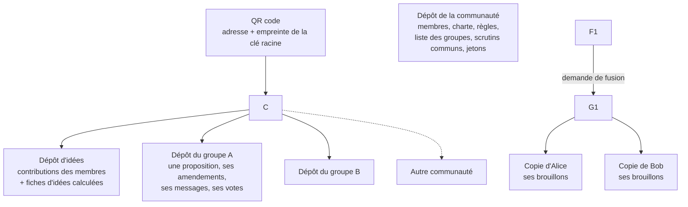

# reteKuneAgi, la démocratie délibérative répartie

> \[!warning] Texte d'anticipation  
> Cet article décrit reteKuneAgi **comme s'il fonctionnait entièrement**. Ce n'est pas le cas : au 12 novembre 2026 rien n'est implémenté. Les écrans sont des croquis, les chiffres d'usage et les noms de membres sont inventés. Le but est de vérifier que le projet est compréhensible à un lecteur non informaticien avant de le construire.

> \[!info] Comment lire ce document  
> Il se suffit à lui-même. L'**avant-propos** dit d'où vient le projet : le logiciel Nova-Ideo, l'article de 2017 que ce texte réécrit, l'état du code en 2026, et les deux travaux récents dont il réutilise les idées, Biblioteko et OSIA. Les **sections 1 à 6** sont l'article proprement dit, écrit du point de vue de l'utilisateur. La **section 7** ouvre le capot pour qui veut savoir comment cela peut tenir sans serveur. La **section 8** dit ce qui ne marche pas encore ou ne marchera jamais. Un **glossaire** et les **références** terminent le document. Les mots en italique suivis d'un astérisque à leur première apparition (*dépôt\**, *fork\**…) sont au glossaire.

# Avant-propos : d'où vient reteKuneAgi

## A. Nova-Ideo et KuneAgi (2013-2026)

En 2013, Amen Souissi soutient à l'Université Lille 1 une thèse préparée au sein d'Ecréall, la société de services en logiciels libres que j'avais fondée : *Modélisation centrée sur les processus métier pour la génération complète de portails collaboratifs* \[1]. L'idée est de décrire formellement les processus d'une organisation (qui fait quoi, dans quel ordre, à quelle condition) puis de **générer** tout le portail à partir de cette description. La preuve de concept est une boîte à idées collaborative, baptisée **KuneAgi**, « agir ensemble » en espéranto.

Réécrite à la main et généralisée, cette boîte à idées devient en 2014 **Nova-Ideo**, un logiciel libre (licence AGPL v3) d'innovation et de démocratie participatives \[2]. Il est écrit en Python avec le cadriciel web Pyramid ; ses données vivent dans une base de données objet (ZODB) et ses processus sont exécutés par un moteur maison issu de la thèse (DaCE). Nova-Ideo est retenu en 2016 par Etalab pour la boîte à outils du Partenariat pour un gouvernement ouvert \[3], et déployé pour plusieurs organisations. Le nom KuneAgi reste celui de la variante de Cosmopolitical \[4], coopérative de droit européen qui s'en sert pour délibérer, finance son développement comme logiciel libre et y a fait ajouter ses propres règles : scrutins supplémentaires, « citoyenneté » (vérification de l'identité des membres par leurs pairs), courriels, traduction allemande.

Ecréall cesse son activité en 2023. Le code est repris en 2024 par Logikascium, l'EURL que j'ai fondée et par laquelle j'exerce comme indépendant, sous le nom KuneAgi. Il fonctionne, mais sur un socle technique figé en 2017 dont plusieurs briques ne sont plus maintenues par personne, et sa modernisation est engagée depuis 2025. La section C dit précisément où il en est.

## B. L'article de 2017

Le 5 mars 2017, j'ai publié *Nova-Ideo, l'innovation participative agile* \[5], une présentation détaillée du logiciel pour un public d'informaticiens. Le présent document en reprend le plan, section par section. Voici ce qu'il disait, pour qui ne l'a pas lu.

* **Le constat.** Les outils de consultation font voter et commenter la foule ; ils suscitent de l'enthousiasme puis croulent sous le nombre d'idées. Nova-Ideo veut faire *réfléchir* la foule, pas seulement la compter.
* **L'idée est personnelle, la proposition est collective.** On s'identifie à son idée : la critiquer, c'est critiquer son auteur. Une idée n'a donc qu'un auteur et ne se modifie plus une fois publiée ; on peut seulement la dupliquer. Une proposition, elle, est écrite à plusieurs.
* **De petits groupes.** Au-delà d'une douzaine de personnes on ne se connaît plus assez pour travailler en confiance. Un groupe de travail est limité à 12 participants, et un membre à 5 groupes. Mieux vaut plusieurs petits groupes en concurrence qu'un grand.
* **Des itérations courtes.** Le groupe travaille par cycles à durée limitée. À la fin de chaque cycle il vote : publier, ou continuer ; et dans ce cas, pour combien de temps et selon quel mode.
* **Trois modes de co-écriture.** *Wiki* : chacun modifie, sans validation. *Validation* : chaque modification est relue par un autre. *Amendements* : chacun modifie de son côté, regroupe ses modifications par intention, les justifie, et le groupe vote.
* **Le jugement majoritaire.** Les amendements concurrents sont départagés par ce mode de scrutin \[6] : on ne choisit pas un candidat, on donne une mention à chacun, et la meilleure mention médiane l'emporte.
* **Des jetons rares.** Chaque membre dispose de 7 jetons pour soutenir ou rejeter ce qui est publié. Quand il n'en a plus, il doit en reprendre un : il arbitre.
* **Des comités.** Un comité de pilotage se prononce sur les propositions et publie son avis sous la forme d'un feu tricolore.

Tout cela reste pour une bonne part juste, et reteKuneAgi **conserve** cette part:

- faire réfléchir,
- en petits groupes de travail, spontanés et éphémères,
- en itérations courtes,
- deux modes de co-écriture, selon l’existence ou non de conflit,
- des jetons rares pour indiquer la priorité,
- le jugement majoritaire pour choisir la solution préférée parmi plusieurs,
- l’exécution concrète, par une instance dédiée, des actions sélectionnées.

En revanche, les points suivants sont **abandonnés** : 

- la notion d’idée. Trop générique, elle n’oriente pas suffisamment vers l’action (cf. infra §3.1),
- l’attachement d’une idée à une personne seule. Cela flatte son ego, mais nuit au partage dans une document ayant vocation à être porté collectivement, ce qui pousse au contraire à reconnaître et valoriser des auteurs multiples,
- le mode de co-écriture intermédiaire par “validation”, dont le cas d’usage est peu clair et surtout limité à la correction orthographique / de forme
- la capacité pour le “comité de pilotage“ de ne pas exécuter une action sélectionnée (droit de veto qu’implique l’usage d’un feu “rouge” ou “orange”).

Ce que l'article ne disait pas, parce que cela allait de soi à l'époque : Nova-Ideo est **un serveur**. Quelqu'un l'héberge, l'administre, détient la base de données, la liste des membres et les bulletins de vote. Et le tri des idées (lire, rapprocher, dédoublonner) reste un travail humain qui ne passe pas à l'échelle.

## C. Où en est le code en 2026

En juillet 2026, j'ai fait auditer les cinq dépôts de code de la lignée et établir un plan de modernisation \[20]. Ce que l'audit a trouvé explique pourquoi l'idée d'une version 2 d'une autre nature s'est imposée.

| Dépôt     | Rôle                                     | Dernière modification | Taille                                         |
|-----------|------------------------------------------|-----------------------|------------------------------------------------|
| nova-ideo | L'application d'innovation participative | mars 2020             | 71 700 lignes de Python, 439 gabarits de pages |
| KuneAgi   | La variante de Cosmopolitical            | mars 2023             | 81 500 lignes de Python                        |
| dace      | Le moteur qui exécute les processus      | décembre 2017         | 13 800 lignes                                  |
| pontus    | La couche des pages et des formulaires   | janvier 2018          | 4 300 lignes                                   |
| daceui    | L'affichage des actions et des processus | décembre 2018         | 1 700 lignes                                   |

L'application connaît une trentaine de types de contenus (idée, proposition, amendement, scrutin, appel à idées, groupe de travail, jeton…) et **24 familles de processus**, décrites par 92 fichiers. Tout est sous licence AGPL v3 : la lignée Nova-Ideo appartient à Logikascium, les apports propres à KuneAgi à Cosmopolitical, et la même licence des deux côtés permet au code de circuler dans les deux sens.

Le diagnostic tient en quatre points.

* **Une architecture saine, sur un socle hors d'âge.** L'ensemble est cohérent et bien construit pour son époque, mais il dépend de versions de 2017 du langage Python, du cadriciel web et de la base de données, qui ne reçoivent plus aucun correctif de sécurité.
* **Une brique de fondation orpheline.** Tout l'édifice repose sur une bibliothèque (substanced) qui n'a jamais connu de version stable et n'a plus de feuille de route : qui veut continuer doit en devenir le mainteneur.
* **Un moteur de processus à réécrire en partie.** Sa mécanique d'événements et de minuteries date de 2015 et s'appuie sur des composants abandonnés.
* **Une connaissance concentrée.** Le développeur principal, auteur d'environ 85 % des modifications, a quitté le projet en 2019. La documentation d'architecture n'existe pas.

Le plan retenu redresse cela par étapes, en maintenant le service : reprendre le contrôle des dépôts, reconstruire à l'identique l'ancienne version pour disposer d'un étalon, documenter, porter le socle sur un Python actuel, refaire l'interface, puis migrer les données. C'est plusieurs mois de travail pour retrouver, à l'arrivée, exactement les mêmes fonctions sur une base saine.

La dernière étape du plan est celle qui a tout déclenché. Dès 2021, j'avais dressé un bilan d'usage de Nova-Ideo qui demandait trois évolutions : l'**anonymisation** des participations, une interface **plus simple pour le jugement majoritaire**, et la **fusion automatique des idées voisines**, que nous pensions alors confier à un modèle de langue français de l'époque. Cette fusion n'a jamais été faite. En 2026, un modèle de langage généraliste la fait sans difficulté, ainsi que le rattachement des idées aux propositions, la synthèse des discussions et l'aide à la rédaction des amendements.

D'où la question que pose ce document. Puisqu'il faut de toute façon refaire le socle, et puisque le tri des idées peut être confié à des machines, faut-il reconstruire le même serveur en plus récent, ou changer la nature de l'outil ? La modernisation garde KuneAgi en service. reteKuneAgi explore l'autre réponse.

## D. Deux travaux de 2026 dont reteKuneAgi réutilise les idées

**Biblioteko** \[7] est un projet de bibliothèque numérique libre et décentralisée, pour une association qui numérise des livres et les prête. Sa version 2, spécifiée en novembre 2026 et pas encore développée, repose sur quelques décisions qui n'ont rien de propre aux livres :

* un livre est un ensemble de fichiers texte ordinaires, lisibles sans logiciel particulier ;
* chaque livre a son propre *dépôt*\*, que n'importe qui peut copier et modifier de son côté ;
* les membres s'échangent des **catalogues**, c'est-à-dire des listes de dépôts, par un simple QR code ;
* l'état d'un livre (à vérifier, publié, prêté) est écrit **dans le fichier lui-même**, dans son en-tête, et non dans une base de données ;
* les décisions importantes sont **signées** numériquement par ceux qui les prennent, et chacun peut vérifier ces signatures chez soi, sans réseau.

Remplacez « livre » par « proposition » et « bibliothécaire » par « groupe de travail » : c'est une plateforme de délibération sans serveur.

**OSIA** (*Obsidian Operating System IA*) \[8] est une méthode que j'enseigne pour tenir un système d'information personnel dans de simples fichiers texte, assisté par des intelligences artificielles. Trois de ses règles servent ici :

* le fichier texte est la mémoire durable ; son en-tête structuré est à la fois la fiche descriptive et la mémoire d'état ;
* l'emplacement d'un fichier ne dit rien de son état : on ne déplace pas un document de « à valider » vers « validé », on change une ligne de son en-tête ;
* l'IA **propose**, le système **vérifie**, l'humain **décide** ; et tout doit continuer à fonctionner sans IA.

## E. L'idée de reteKuneAgi

Garder de Nova-Ideo tout ce qui concerne les personnes (les petits groupes, les itérations, les amendements, le jugement majoritaire, les jetons) et remplacer tout ce qui concerne la machine. Plus de serveur : des dépôts de fichiers que les membres se partagent. Plus de base de données : l'état est dans les fichiers. Plus d'administrateur à croire sur parole : des signatures que chacun vérifie. Plus de tri manuel des idées : les Problèmes sont regroupés, par des étiquettes (“*tags*”) ou par des agents d'IA qui rangent, sans jamais décider (cf. infra, § 3.3).

***En 2017, j'écrivais que la plupart des outils de la « CivicTech » faisaient travailler la foule, et que Nova-Ideo voulait la faire réfléchir. Neuf ans plus tard l'ambition est la même, mais il n'y a plus de plateforme : ni serveur, ni base de données, ni administrateur. Il reste des textes, des signatures, et des gens qui se mettent d'accord.***

# 1. Élaborer et sélectionner démocratiquement les actions d’un collectif

## 1.1 L’unique fonction de reteKuneAgi

L'outil reteKuneAgi a pour **seule fonction** d’**élaborer** et de **sélectionner**, **démocratiquement**, les **actions** engageant les ressources (en temps de travail humain, en capacité d’utilisation d’équipements, en argent) d’un **collectif** (coopérative, association, syndicat, entreprise, collectivité publique), et **uniquement celle-là**. Il est, et doit être, orienté vers l'action, vers la transformation du monde, et uniquement vers cela. C'est pourquoi il s'appelle "Kune Agi", soit “agir ensemble” en Espéranto. Le préfixe “rete”, soit “par le réseau” en Espéranto, indique le moyen technique, décentralisé, de réalisation de cette fonction. 

Ce n'est pas un assistant à la création littéraire, ni à la découverte de la vérité philosophique, technique ou scientifique, ni au débat d'idées en général. Cette spécialisation fonctionnelle est délibérée, et constitue une caractéristique essentielle de l’outil.

Cette spécialisation fonctionnelle de reteKuneAgi se fonde sur les caractéristiques fondamentales de la décision sur des actions à une échelle collective, énoncées ci-dessous, et qui justifient les choix faits pour l’outil lui-même.

## 1.2 L’orientation vers l’action implique des jugements de valeur humains

Définir une action à une échelle collective implique de se **mettre d’accord** sur : 

1. l’existence et la nature de **problèmes**, c’est-à-dire d’aspects de l’état du monde qui sont jugés insatisfaisants, injustes ou condamnables. En effet, l’action ne se justifie que si elle transforme un état du monde jugé insatisfaisant. S’il est satisfaisant, il est préférable (et plus économe de ressources) de ne rien faire. Les faits sont objectivables. Le jugement moral porté sur les faits ne l’est pas. C’est un jugement de valeur, que seul un humain peut exprimer en fonction de ce qui est important pour lui / elle ;
2. l’**action** à mener pour traiter le problème (y remédier, l’atténuer ou en atténuer les conséquences), ce qui implique à nouveau des jugements de valeur purement humains portant sur : 
   - le fait qu’il est préférable d’agir plutôt que de ne rien faire, en comparant les coûts et bénéfices de l’action et de l’inaction, leur répartition dans la société et au cours du temps;
   - le choix entre les différentes actions envisageables pour traiter le problème, à nouveau selon leurs coûts et bénéfices respectifs.

Un **jugement de valeur humain** est donc au cœur de l’identification et de la caractérisation des problèmes, comme de la définition des actions à mener pour les traiter. Ce jugement de valeur n’est pas de l’ordre de la vérité scientifique ou technique. 

La **science** et la **technique** , qui elles sont de l’ordre de la vérité et de l’erreur, ont un rôle, fondamental, à jouer dans la discussion sur l’action. Elles donnent accès aux **chaînes causales** qui sont déterminantes, tant dans l’identification des problèmes que dans l’élaboration des actions cherchent à les traiter :

- quelles sont les causes des problèmes identifiés ?
- quelles sont les conséquences prévisibles de l’inaction, et de chacune des actions envisagées pour traiter le problème ?

En revanche, elles n’ont aucune légitimité à établir le jugement de valeur, moral ou éthique, porté sur l’état du monde, ou sur les conséquences prévisibles de l’inaction ou de l’action.

## 1.3 Seule la délibération démocratique est légitime pour énoncer les jugements de valeur justifiant des actions collectives

Dans la mesure où : 

- les opérations fondamentales nécessaires à la définition d’une action collective impliquent des jugements de valeur, 
- ces jugements de valeur sont humains et non objectivables,
- les actions collectives ont des conséquences à l’échelle du collectif qui les portent (et en général au-delà),

**seule** la **délibération** de **tous les membres du collectif** engageant l’action, voire de toutes les parties prenantes, à savoir des entités (humaines et non-humaines, présentes et futures) susceptibles de subir les conséquences de cette action est **légitime** pour énoncer ces jugements de valeur menant à une action collective. Par “délibération”, nous entendons la discussion, respectueuse des intérêts et valeurs de chacun.e, visant à une conclusion, entre les parties participant à la discussion, avec l’ouverture de chacune d’entre elles à être convaincue par les arguments des autres.

Compte tenu du principe d’égalité en droits de tous les humains, cette délibération doit de surcroît être **démocratique**, à savoir donner les mêmes droits à chacune et chacun.

## 1.4 L’architecture distribuée en réseau est seule compatible avec la démocratie

L’ambition démocratique a une implication forte sur l’architecture informatique de l’outil soutenant les processus de définition d’actions collectives. Sur le principe, une architecture centralisée, s’appuyant sur un serveur, crée une asymétrie entre le détenteur du serveur et les autres. Elle crée de surcroît une vulnérabilité : si le serveur est détruit, l’ensemble du système s’arrête.

Au contraire, une architecture **distribuée**, en réseau et sans point central, assure à la fois  : 

- la **robustesse** contre les attaques et
- l’**égalité démocratique** entre tous les membres de la communauté.

# 2. Ce que reteKuneAgi retient (ou non) des travaux antérieurs

Le constat de 2017 (rappelé au § B de l’introduction ci-dessus) tient toujours. Qu'on parle de démocratie participative ou d'innovation participative, on demande leur avis à des personnes en les faisant voter ou commenter, et l'écueil est le même : susciter de l'enthousiasme puis ne pas savoir répondre au trop grand nombre d'idées et de commentaires.

Ces outils sont confrontés à un autre écueil important : ils travaillent sur des documents générés par **une seule  personne** que les autres peuvent au mieux commenter, aimer / détester, ou classer, mais sans jamais participer à sa rédaction, et en particulier à son amendement. Le résultat est qu’on se retrouve face à une multiplicité de propositions proches, sans qu’il soit donné les moyens à leurs auteurs de coopérer pour trouver un terrain d’entente satisfaisant les attentes de plusieurs personnes, ou de mettre ensemble des éléments de solution qui se soutiennent mutuellement. L'enjeu est donc de passer de l'expression **individuelle** à l'expression **collective**, en amenant à une rédaction **collaborative** des documents, sans pour autant tomber dans les écueils des conflits d'annulation d'amendements des wikis, ni dans les solutions autoritaires où un modérateur / un supérieur hiérarchique met tout le monde d'accord en prenant la décision à la place des participants.

Au-delà de ces éléments stables, deux choses ont changé depuis.

La première est la **perte de confiance**. Une consultation hébergée par celui qui la commande reste, pour beaucoup de participants, de la communication (au sens d'une opération visant à se faire bien voir sans en tirer de conséquence dans l’action, et donc non crédible) : qui tient le serveur tient la liste des votants, l'ordre d'affichage et le bouton de suppression. reteKuneAgi retire le serveur. Chaque membre détient une copie complète et signée de tout ce qui a été écrit et voté ; personne ne peut réécrire l'histoire sans que cela se voie, et un groupe en désaccord peut partir avec toutes les pièces.

La seconde est l’apparition d’**outils automatiques de tri**. Le travail qui épuisait les animateurs de Nova-Ideo (lire toutes les idées, repérer les doublons, les regrouper, les rattacher aux propositions) est fait par des modèles de langage. Ils ne décident de rien : ils rangent.

Le reste est inchangé. reteKuneAgi fait fonctionner :

* l’**initiative**, ouverte à tous les membres de la communauté, d’écriture de problèmes ou des propositions d’action,
* la co-écriture collaborative, par successions d’**amendements**, de problèmes à résoudre et de propositions d'action (candidates pour résoudre les problèmes) par de petits groupes, avec des processus clairs et démocratiques de résolution de conflits,
* la **sélection** par la communauté des problèmes à traiter en priorité et des propositions d’action les plus pertinentes pour répondre à ces problèmes.

Sa force reste la *coopétition* des cycles itératifs du logiciel libre, dont il emprunte cette fois aussi les outils : *Git*\*, les *forks*\*, les *demandes de fusion*\*.

# 3. Rejoindre plutôt qu'installer

En 2017, il fallait installer Nova-Ideo par Docker ou s'abonner au service en ligne. Dans reteKuneAgi, il n'y a plus rien à installer côté communauté, puisqu'il n'y a plus de côté communauté : une communauté est un dépôt de fichiers qui recense les dépôts de ses groupes de travail, et que l'on rejoint en scannant un QR code.

!\[\[réflexions/réflexions_images/kuneagi_v2_croquis_01_rejoindre.excalidraw\]\]

*Croquis 1 (mobile) : rejoindre une communauté. On scanne, l'application vérifie l'empreinte de la clé racine, crée les clés du membre et dépose la candidature.*

## 3.1 Deux modalités d’admission

L'**admission** comprend **deux modalités** :

* un mode **léger**, mais vulnérable, où il suffit de produire une preuve (ou une forte présomption d'humanité) pour être admis. C'est fluide, rapide, sans friction, mais c’est vulnérable à la multiplication des comptes par une même personne, ce qui contredit le principe démocratique "*une personne = une voix*",
* un mode **robuste**, assurant le principe démocratique, mais plus lourd, qui reprend le processus de citoyenneté de KuneAgi :
  * la machine vérifie que le candidat, identifié par le triplet identifiant (prénoms, noms, date de naissance) n’a pas déjà un compte (en confrontant le *hashcode\** de ce triplet identifiant avec la liste des hashcodes de membres enregistrés),
  * des membres tirés au sort vérifient que le candidat est une personne réelle, qu’il vérifie les conditions éventuelles placées sur la participation à la communauté (membre d’une association ou d’un syndicat, nationalité, âge de la majorité), que le triplet identifiant qu’il a déclaré correspond à celui de documents officiels probants, puis signent.

La communauté ne connaît de ses membres que:

- un pseudonyme,
- ses clés publiques, 
- ses préférences linguistiques,
- le texte de présentation qu’iel aura partagé s’iel le souhaite,
- une image d’avatar,
- sa note de comportement coopératif (cf. infra),
- la date de dernière mise à jour de son comportement coopératif, et 
- (dans le mode d’admission “robuste”) la liste des hashcodes des membres enregistrés.

Pour faire basculer une communauté du mode d’admission “léger” vers le mode “robuste” (et donc se débarrasser des comptes multiples), il suffit qu’un membre crée un *fork\** du dépôt, en mode d’admission “robuste”, en appelant les membres à le rejoindre.

## 3.2 La gestion des indésirables

La **gestion des indésirables** traite des personnes suivantes, susceptibles de se multiplier, surtout dans le mode d’admission “léger” en profitant de la facilité à créer un compte :

* les trolls, qui suscitent la confrontation et le clivage par jeu, par calcul visant à nuire, par perfectionnisme pathologique ou par histrionisme,
* les saboteurs divers (volontaires ou non).

L’action de ces indésirables nuit au travail de toute la communauté, en distrayant de la capacité de travail en direction de la réponse aux provocations ou de la réparation / contention des dommages.

L’outil choisi par KuneAgi, et repris dans reteKuneAgi, est la **réputation indélébile, mais fongible**. À chaque membre est attachée une **note de comportement coopératif**, résultant des notes reçues des autres membres des Groupes de Travail auxquels il a participé. Au terme de la participation de ce membre à un Groupe de Travail contribuant à la rédaction d’un document, les autres membres de ce Groupe de Travail lui donnent l’une des trois notes suivantes : 

- **-1** si le comportement coopératif a été **en-dessous** de ce que la personne attendait,
- **0** si le comportement coopératif a été **conforme** à ce que la personne attendait,
- **+1** si le comportement coopératif a été **au-dessus** de ce que la personne attendait.

Les notes reçues de tous les membres du Groupe de Travail s’additionnent. La note de comportement coopératif décroît ensuite au cours du temps (elle “fond”), en étant divisé par deux tous les 6 mois (ce paramètre numérique est ajustable).

Un membre ayant une mauvaise note de comportement coopératif se voit progressivement exclu des Groupes de Travail auxquels il souhaiterait participer, lorsqu’il présente aux membres existants sa candidature pour le faire, ou lorsqu’il cherche à convaincre d’autres de le rejoindre dans un Groupe de Travail qu’il crée. Le caractère fongible de la note assure que la sanction n’est pas éternelle, et que le membre qui change positivement son comportement coopératif est progressivement réintégré dans la communauté.

## 3.3 L’expulsion des indésirables

Lorsque ce mécanisme dissuasif ne fonctionne pas, il devient nécessaire de disposer des moyens techniques de **faire sortir de force** c’est-à-dire d’**expluser**, ces indésirables, une fois que la décision (par vote / au terme d'une procédure de type judiciaire - cf. les [Statuts de la Coopérative CosmoPolitique](https://www.cosmopolitical.coop/OverviewStatutes) § 3.3.23 à 3.3.25 - Procédures d'Enquête) de le faire a été prise. **Ces moyens techniques ne sont, à ce jour, pas définis.**

# 4. Première utilisation : dire quelque chose

## 4.1 Trois modalités d’utilisation de reteKuneAgi

Trois façons d'utiliser reteKuneAgi coexistent, sur les mêmes fichiers :

* l'**application mobile**, pour contribuer, discuter, voter ; elle cache entièrement Git et les clés ;
* le **poste de travail**, pour écrire longuement et préparer des amendements : l'éditeur de notes Obsidian \[9] ou le portail local, qui n'est qu'une vue sur les dépôts clonés ;
* la **ligne de commande**, pour vérifier, dépouiller, automatiser. Tout ce que font les deux autres passe par elle.

Les dépôts sont hébergés où la communauté le souhaite, sur au moins deux *forges*\*, qui peuvent le cas échéant être **auto-hébergées** par des membres de la communauté, afin de ne pas dépendre de ressources étatsuniennes. Aucune n'est indispensable : deux membres peuvent s'échanger un groupe de travail entier par clé USB.

## 4.2 Deux catégories de documents : Problèmes et Propositions d’Action

La section 1 de ce document “ Élaborer et sélectionner démocratiquement les actions d’un collectif” explique pourquoi les documents générés par reteKuneAgi appartiennent à deux catégories de documents, et deux seulement, comme décrit dans les [Statuts de la Coopérative CosmoPolitique](https://www.cosmopolitical.coop/OverviewStatutes) (§3.3.14):

1. des **Problèmes** (ou "*issues*" en anglais), c'est à dire des descriptions de situations dans le monde jugées négativement, et qui demandent donc à être transformées. Cela comprend les sections suivantes : la nature du problème, l'explication de pourquoi c'est un problème, éventuellement la quantification du problème, qui est affecté et une première idée des causes du problème. Cela correspond à la notion d'"appel à idées" sur Nova-Ideo, avec la différence qu'ici tout le monde est habilité à formuler un problème (pas seulement le Comité de Pilotage).
2. des **Propositions d'Action**, c'est à dire des descriptions d'actions susceptibles de résoudre ou d'atténuer le Problème, et donc d'atteindre un état du monde jugé meilleur. Cela comprend les sections suivantes : la description de l'action, la justification de pourquoi cette action devrait être efficace pour résoudre ou atténuer le Problème (en particulier comment cela agit sur les causes identifiées du problème), si possible une quantification de l'effet et des coûts engagés, une présentation des solutions alternatives envisagées et une justification de pourquoi elles n'ont pas été retenues.

La nature précise des sections dans chaque document dépend de la Nature de l’Action (cf. infra §4.3).

### 4.2.1 Graphe des liens entre Problèmes et Propositions d’Action

Une Proposition d'Action se rattache à préférentiellement à un seul Problème qu’elle recendique résoudre ou atténuer, à l’initiative de son Groupe de Travail, mais a le droit se se rattacher à plusieurs (avec un nombre maximal paramétrable, par exemple égal à 5), en particulier pour prendre en compte le fait que des Problèmes peuvent être proches sans s’être regroupés (cf. infra). Dans l’autre sens, un même Problème peut être l’objet du rattachement de plusieurs Propositions d'Action, concurrentes pour le résoudre (c'est même souhaité !), mais son Groupe de Travail n’a pas le contrôle des Propositions d’Action qui choisissent ou non de s’y rattacher.

### 4.2.2 Sélection et regroupement des Problèmes

La **sélection** entre les **Problèmes** s'effectue par des **Jetons de Priorité**, dont chaque membre de la communauté ne dispose qu'en nombre limité (une valeur par défaut de 7 est suggérée pour commencer). Poser un Jeton de Priorité, c'est signer. Le plafond de sept est contrôlé dans le dépôt de la communauté, seul endroit où tous les Jetons de Priorité d'un membre sont visibles ensemble. Ces Jetons de Priorité expriment la gravité du Problème, et donc l’importance et l’urgence de sa résolution. Les Problèmes ayant reçu le plus grand nombre de Jetons de Priorité sont placés en tête. 

Les **Problèmes** ont donc vocation à se **regrouper**, pour collecter le maximum de ces Jetons de Priorité, sans dispersion entre des Problèmes analogues. Les modes de regroupement sont les suivants : 

- par **tri sur des étiquettes pré-définies** (“*tags*”). Les documents, et donc en particulier les Problèmes, sont associés, lors de leur création puis au cours de leur vie, à des étiquettes (“*tags*”) à choisir dans un jeu fixe (par exemple, celui fourni dans l’annexe 7 des [Statuts de la Coopérative CosmoPolitique](https://www.cosmopolitical.coop/OverviewStatutes)), éventuellement avec assistance pour cette association par l’IA. Un filtre banal de recherche sur ces étiquettes filtre et regroupe les Problèmes portant les mêmes étiquettes, et donc proches les uns des autres;
-  avec **assistance** par une **Intelligence Artificielle (IA)**, si elle est disponible,  pour suggérer des rapprochements.

Dans les deux cas, les Groupes de Travail ayant élaboré des Problèmes identifiés comme proches votent sur l’opportunité ou non de fusionner. Seuls les Problèmes dont les Groupes de Travail correspondants ont approuvé démocratiquement la fusion par leur vote le sont effectivement. Le document résultant de la fusion est simplement la concaténation, section par section, des documents qui fusionnent. Les listes des auteurs sont également concaténées, avec les pseudonymes rangés par ordre alphabétique. Chaque section ainsi fusionnée est ensuite résumée, à la main ou avec l’aide de l’IA si elle est disponible, pour aboutir à une description de Problème intégrant les contributions de tou.te.s. 

### 4.2.3 Sélection des Propositions d’Action

La **sélection** entre les **Propositions d'Action** en concurrence pour résoudre un même Problème qu’elles revendiquent de résoudre ou d’atténuer, et auquel elles se sont explicitement rattachées, se fait par **Jugement Majoritaire**.

Les Propositions d’Action ne fusionnent donc pas explicitement. L'amélioration coopérative résultant du rapprochement de plusieurs Propositions d'Action s'opère par création d'une nouvelle Proposition d'Action reprenant les éléments jugés pertinents des Propositions d'Action d'origine, par un nouveau Groupe de Travail, avec ou sans le consentement des Groupes de Travail ayant élaboré les Propositions d’Action d’origine. Les Propositions d’Action d’origine sont conservées si leur Groupe de Travail le souhaite.

!\[\[réflexions/réflexions_images/kuneagi_v2_croquis_02_contribuer.excalidraw\]\]

*Croquis 2 (mobile) : la contribution remplace le formulaire de création d'idée de 2017. On écrit, on publie ; le brouillon reste dans sa copie personnelle.*

## 4.3 Les Natures d’Action

 Les actions que la communauté peut être amenée à engager, et qu’elle souhaite soumettre au processus incarné par reteKuneAgi, appartiennent à une **liste définie d’avance**, modifiable elle-même par la communauté, de **Natures d’Actions**. Un exemple d’une telle liste de Natures d’Action est donné par le § 3.2 des [Statuts de la Coopérative CosmoPolitique](https://www.cosmopolitical.coop/OverviewStatutes).

À chaque Nature d’Action correspond un **format** de document de Problème et un format de document de Proposition d’Action. Un format de document correspond à une table des matières des sections de ce document, avec un guide pour le remplir. Un **modèle** existe pour chaque catégorie (Problème ou Proposition d’Action) et pour chaque Nature d’Action. Ce modèle est utilisé lors de la création du document. Un exemple de tels modèles de documents est proposé par la Coopérative CosmoPolitique.

## 4.4 La première contribution

Le membre ne saisit ni titre ni mots-clés. Il indique seulement s'il écrit un Problème ou une Proposition d’Action, et la Nature de l’Action correspondante. Le système lui fournit alors une copie du modèle de document correspondant. Il s’aide pour réfléchir des indications et questions de chaque section du document, et remplit les sections qu’il souhaite. Il ajoute une ou plusieurs étiquettes (“*tags*”) de la liste pré-définie, en s’aidant s’il le souhaite d’un outil d’IA.

Tout cela est fluide, et comme en 2017, chaque geste engage la nature du travail. La différence est que l'engagement est visible : publier, c'est signer.

Dès que le document est publié, il constitue un appel à constituer un Groupe de Travail autour de lui. La présence des étiquettes aide les autres membres à détecter que ce nouveau document présente de l’intérêt pour eux (cf. infra § 4.10 Notifications).

!\[\[réflexions/réflexions_images/kuneagi_v2_croquis_03_accueil.excalidraw\]\]

*Croquis 3 (PC) : l'accueil. Les appels à idées en tête, mes groupes, puis les idées calculées et les propositions, triées et filtrées. Les flèches sont les jetons de soutien et d'opposition.*

# 5. Les processus

## 5.1 L’initiative est ouverte à tou.te.s

Tout membre de la Communauté peut librement créer et publier autant de documents qu’il ou elle souhaite. Par défaut, le premier auteur d’un document est le premier Membre Actif du Groupe de Travail correspondant à ce document.

Pour autant, un même membre ne peut être le Membre Actif que d’un nombre limité de Groupes de Travail pour une Nature d’Action donnée (par exemple : pas plus de 5 Groupes de Travail pour des Propositions de Politique Publique, pas plus de 1 Proposition de Prototype d’Entreprise, etc…). Ces paramètres sont également modifiables par la communauté, au choix de celle-ci (les [Statuts de la Coopérative CosmoPolitique](https://www.cosmopolitical.coop/OverviewStatutes), §3.4.1, tableau portant sur la section 3.3.1, donnent un exemple de telles limites). La justification de cette restriction est de forcer à un travail suffisamment concentré pour être de qualité. On ne peut pas conserver en tête les enjeux et les discussions sur un nombre de sujets trop élevé. 

Le membre doit donc d’abord quitter le Groupe de Travail d’un document s’il souhaite faire partie de celui d’un autre qui l’amènerait à dépasser son quota.

## 5.2 Le fork des contenus

En 2017, « fork » était une métaphore empruntée au logiciel libre. C'est maintenant le mécanisme lui-même.

Dupliquer une proposition, c'est copier le dépôt du groupe : texte, historique, amendements, votes, tout vient avec, et la paternité de chaque phrase reste inscrite. Un nouveau groupe peut repartir du travail d'un autre, quel que soit son état. Le travail n'est jamais perdu, et il est malléable à souhait.

Le fork a pris deux autres rôles.

* **Le brouillon.** Tout ce que je n'ai pas encore soumis vit dans ma copie personnelle. Il n'y a plus de bouton « enregistrer sans publier » : il y a ma copie, et le dépôt commun.
* **Le désaccord.** Un groupe qui se divise ne se bloque pas : une partie poursuit dans une copie, et les deux propositions concurrentes seront soumises au soutien de tous. C'est exactement « plusieurs petits groupes en concurrence sur le même sujet », que je recommandais en 2017 sans avoir l'outil pour.

L'historique des versions n'est plus une fonction : c'est une fonction réalisée nativement par Git.

## 5.3 Les cartes des contenus

Nova-Ideo traçait les duplications et les réutilisations et permettait de naviguer dans le graphe des parentés. La carte existe toujours, et elle est plus riche parce qu'elle ne dépend plus de ce que les gens ont pensé à déclarer.

!\[\[réflexions/réflexions_images/kuneagi_v2_croquis_05_carte.excalidraw\]\]

*Croquis 5 (PC) : la carte des contenus. Les liens de parenté ne sont plus saisis : ils sont lus dans les frontmatters et dans l'historique des dépôts.*

Chaque fichier dit dans son en-tête (son *frontmatter*\*) de quoi il est tiré, à quoi il répond, ce qu'il amende. Sur le poste de travail, la vue graphe d'Obsidian affiche cette carte sans rien développer.

## 5.4 Le travail en groupe

L'homme a un comportement essentiellement coopératif. Il forme des groupes pour résoudre des problèmes, et la communication devient alors l'activité principale : plus le groupe échange, plus il a de chances d'aboutir ; plus les profils sont complémentaires, meilleures sont les solutions. Si les cultures diffèrent il faut du temps pour se comprendre, et si les convictions s'opposent il faut orchestrer le débat pour en tirer la richesse plutôt que le règlement de comptes.

Nova-Ideo orchestrait par un processus métier paramétrable, « en attendant d'avoir un éditeur de processus intégré ». Cet éditeur n'a jamais existé et n'est plus nécessaire : un processus est un document. La définition des étapes d'une proposition (qui peut faire passer de quel état à quel autre, avec quelle signature, à quelle condition) est un fichier lisible, placé dans le dépôt de la communauté, que celle-ci modifie par un vote comme n'importe quel texte.

Un **Groupe de Travail** naît de la **publication** d’un document (Problème ou Proposition d’Action) par le membre de la communauté qui en est le premier auteur . Ce Groupe de Travail reçoit un dépôt où ce document est stocké. Le Groupe de Travail ne devient **actif**, c’est-à-dire qualifié pour commencer à amender le document initial, que s’il atteint un nombre minimum de Membres Actifs, son **quorum**. Ce quorum, éventuellement défini en fonction de la Nature d’Action que traite le document, fait partie des paramètres quantitatifs fixés au départ et modifiables par la communauté.

!\[\[réflexions/réflexions_images/kuneagi_v2_croquis_07_proposition.excalidraw\]\]

*Croquis 7 (PC) : la proposition, découpée en sections. À gauche l'état de l'itération ; à droite le texte, son fil de discussion et la synthèse, toujours signalée comme écrite par une machine.*

## 5.6 La taille de groupe optimale

Rien à retirer à ce que j'écrivais. Dès qu'un groupe dépasse la dizaine de personnes, ses participants ne se connaissent plus assez pour être en confiance, donc spontanés et efficaces. Certains se mettent en retrait, et le nombre de discussions avant action explose. Il faut dépasser la centaine pour retrouver, par le nombre, l'efficacité d'un groupe de moins de douze ; et un grand groupe qui cherche à s'organiser aboutit le plus souvent à une pyramide qui étouffe les idées de sa base.

La solution reste d'avoir plusieurs petits groupes en concurrence sur le même sujet, quitte à ce qu'un autre fusionne leurs propositions.

reteKuneAgi garde donc les valeurs par défaut : **douze participants** par groupe, **cinq groupes** par membre, une liste d'attente au-delà. Ces nombres sont écrits dans la charte de la communauté et se changent par un vote.

Ce qui est nouveau, c'est que la règle du petit groupe est devenue une propriété de l'architecture. Un groupe est un dépôt : douze personnes qui écrivent dans le même dépôt s'entendent, cent se marchent dessus. Et la fusion de deux propositions concurrentes, que je présentais comme un vœu, est une opération ordinaire entre deux dépôts qui ont un ancêtre commun.

## 5.7 Le travail itératif et les modes de co-écriture

Il est rare d'écrire du premier coup une proposition parfaite, encore plus à plusieurs. Le travail est organisé en itérations à durée limitée, selon le *timeboxing* des méthodes agiles, et ce sont les participants qui choisissent la durée.

### 5.7.1 Le choix du mode de travail et de la durée de l'itération

À la fin de chaque itération, les participants votent : publier la proposition, ou repartir pour un nouveau tour d’amendements. S'ils repartent, ils votent aussi la durée de l'itération suivante et son mode de travail.

!\[\[réflexions/réflexions_images/kuneagi_v2_croquis_08_iteration.excalidraw\]\]

*Croquis 8 (mobile) : les trois votes de fin d'itération. Publier ou continuer, puis la durée et le mode de l'itération suivante.*

Deux modes existent toujours, activables selon le nombre de participants. À tout moment un Participant Actif peut quitter son Groupe de Travail, et tout Membre Actif peut partir d'une copie du Document (Problème ou Proposition d’Action) pour créer un nouveau Groupe de Travail concurrent. Les cycles courts évitent l'enlisement ; l'application rappelle les échéances.

### 5.7.2 Le mode wiki (pas de validation des modifications)

Chaque modification enregistrée produit une nouvelle version, sans validation. Ce mode convient dans 80 % des cas, lorsque l’écriture est sans conflit. Son défaut connu était de donner un poids disproportionné à la dernière modification, donc à celui qui joue la montre avant le vote de publication. Ce défaut a disparu : le vote de publication porte sur une version précise, désignée par son empreinte. Une modification de dernière minute produit une autre version, sur laquelle personne n'a voté, et donc qui ne peut être publiée.

Un autre défaut connu est celui de la “guerre d’annulations”, dans laquelle des participants en désaccord passent leur temps à annuler les amendements faits par l’autre, dans une boucle qui, en l’absence d’une autorité supérieure, est sans fin. C’est pourquoi un autre mode de co-écriture, compatible avec l’existence de conflits, est nécessaire. 

### 5.7.3 Le mode avec amendements

Ce mode de co-écriture est adapté à la situation dans laquelle le Groupe de Travail comprend des Membres Actifs avec des positions fortement divergentes, mais qui souhaite néanmoins trouver un moyen de converger vers  un résultat commun de compromis, résultant de décisions démocratiques. Dans ce mode, la co-écriture se fait en parallèle : chacun modifie la proposition de son côté, dans sa copie locale, sans connaître les modifications des autres. Elles seront mises en concurrence lors du vote pour aboutir, après un vote sur chaque amendement, à une nouvelle version.

Reprenons l'exemple de 2017. Un participant modifie la proposition pour en généraliser le sens et en profite pour reformuler quelques phrases. Il y a là plusieurs modifications : certaines servent la généralisation et touchent des phrases dispersées dans le texte, d'autres sont des reformulations indépendantes. Quand il a fini, chaque Membre Actif du Groupe de Travail (1) regroupe s’il le souhaite ses modifications de texte (ajouts, suppressions, substitutions) en des ensembles cohérents en terme de sens, et (2) exprime son intention en proposant cet ensemble sémantiquement cohérent de modifications. Cette entité (ensemble sémantiquement cohérent de modifications de texte, justification) constitue un Amendement.

Constituer ces amendements à  partir des modifications apportées au texte était l'écran le plus difficile de Nova-Ideo, et l'endroit où l'on perdait des participants. C'est celui où l'assistance, optionnelle, par une Intelligence Artificielle (modèle de langage) aide le plus. Elle reste cependant pleinement susceptible d’être réalisée par un humain, moyennant, bien sûr, un effort supplémentaire.

!\[\[réflexions/réflexions_images/kuneagi_v2_croquis_10_amendements.excalidraw\]\]

*Croquis 10 (PC) : le mode avec amendements. On regroupe ses modifications par intention et on les justifie ; l'assistant propose, l'auteur décide et signe.*

L'assistant en IA tourne sur le poste du Membre Actif du Groupe de Travail. Il ne lit que sa copie locale du document, comprenant la nouvelle version du document proposée par ce Membre Actif, et donc, par différence avec la version initiale ou résultant du dernier cycle d’amendements, l’ensemble complet des modifications de texte (ajouts, suppressions et substitutions de texte) que ce Membre Actif propose.

L’assistant en IA propose un regroupement de ces modifications de texte et un premier jet de justification pour constituer un brouillon d’Amendement ; le membre corrige, puis signe chaque Amendement qu’il valide. L'assistant ne soumet rien et ne signe rien.

À l'échéance, les Amendements sont mis au vote par comparaison avec la version d’origine. Les Amendements qui portent sur les mêmes passages sont votés les uns contre les autres, en plus de l’être contre la version d'origine. Savoir si deux Amendements touchent le même passage est un calcul sur le texte, pas une opinion de machine.

## 5.8 Le jugement majoritaire dans le vote sur les Amendements

Le jugement majoritaire, issu des travaux de Michel Balinski et Rida Laraki \[6], répond au défaut du vote classique où l'on n'exprime pas son avis sur tous les choix et où l'on finit par voter pour le moindre mal.

Chaque Membre Actif du Groupe de Travail donne à chaque Amendement concurrent sur un segment de texte, texte d'origine compris, une mention parmi sept : « Excellent », « Très bien », « Bien », « Assez bien », « Passable », « Insuffisant », « À rejeter ». La version retenue est celle dont la mention médiane est la meilleure, avec des règles spécifiques et transparentes pour départager en cas d’égalité.

!\[\[réflexions/réflexions_images/kuneagi_v2_croquis_11_jugement-majoritaire.excalidraw\]\]

*Croquis 11 (mobile) : le jugement majoritaire. Chaque version concurrente, texte d'origine compris, reçoit une mention ; le résultat se recalcule sur son propre téléphone.*

Ce qui est nouveau n'est pas le scrutin, c'est sa vérification. En 2017, « Nova-Ideo calcule la médiane » : il fallait croire Nova-Ideo. Aujourd'hui un bulletin est un fichier signé par son auteur, la liste des votants est figée à l'ouverture, et le dépouillement est un calcul que chaque participant peut refaire sur son téléphone. Le résultat n'est valable que s'il est signé par plusieurs participants qui l'ont recalculé.

Dans un groupe de douze, le vote est nominatif sous pseudonyme : chacun assume ses mentions devant ses pairs. Pour les scrutins de toute la communauté, les mentions restent scellées jusqu'à la clôture, afin que les premiers résultats n'influencent pas les derniers votants.

Une fois les votes sur les Amendements dépouillés, les modifications de texte retenues sont appliquées, une nouvelle version est produite. Cette nouvelle version est alors soumise au vote du Groupe de Travail pour choisir entre la publication immédiate de cette nouvelle version ou le démarrage d'une nouvelle itération d’un cycle d’amendement.

!\[\[réflexions/réflexions_images/kuneagi_v2_croquis_12_version.excalidraw\]\]

*Croquis 12 (PC) : la nouvelle version, fabriquée par le vote. Chaque changement renvoie à l'amendement et au scrutin qui l'ont produit.*

## 5.9 Les fils de discussion

On peut discuter de tout : une proposition, une de ses sections, un amendement, une idée, ou un sujet libre. Un message est un petit fichier signé qui dit à quoi il répond ; un fil n'est rien d'autre que l'ensemble des messages qui parlent du même objet. Images, liens et fichiers joints sont admis.

Deux différences avec 2017, l'une heureuse, l'autre à assumer.

La différence heureuse, si l’usage est fait de l’IA : les longs fils sont résumés. Une synthèse rédigée par un agent IA, toujours marquée comme telle, dit les positions en présence et ce qu'aucun amendement ne couvre encore. Elle ne recommande rien.

Celle qu'il faut assumer : ce n'est pas une messagerie instantanée. Un message part à la prochaine synchronisation et arrive à celle du destinataire. On débat au rythme du courrier, pas à celui du clavardage, et c'est sans doute mieux pour réfléchir.

## 5.10 Les notifications

Nova-Ideo utilisait les notifications du navigateur, poussées par le serveur. Sans serveur, personne ne pousse : chaque appareil regarde ce qui a changé depuis sa dernière synchronisation et en déduit ce qui concerne son propriétaire. La difficulté est alors de savoir, dans la masse potentiellement considérable de contenus qui ont été modifiés depuis la dernière connexion, ce qui concerne ce membre de la communauté. Pour ce faire, il faut établir un filtre qui ne retient que les notifications pertinentes.

Une option importante est que chaque membre de la communauté **pilote son propre filtre**. Par défaut, ce filtre est purement algorithmique, sans intervention d’IA. Le membre de la communauté définit les combinaisons d’étiquettes (“*tags*”) qui l’intéressent (par exemple : “Réunions de cohésion” ET “Réunions en personne” ET “\[Sa région géographique\]”, ou “Action de durabilité d’une entreprise” ET “Secteur du tourisme”, etc…). Le résultat du filtre est simplement celui de la requête dans l’ensemble des étiquettes des documents de la communauté. Cette option demande plus d’effort de formalisation de ses centres d’intérêt, en utilisant le vocabulaire des étiquettes, mais il fournit un résultat contrôlé, répétable et autonome.

Si souhaité, et s’il dispose d’une IA, le membre de la communauté peut paramétrer cette IA pour qu’elle lui filtre les notifications qui l’intéressent, en lui formulant sa requête de façon plus naturelle, mais dont il pilote moins les résultats. Cette option présente les caractéristiques symétriques de la précédente: plus facile, moins contrôlée par l’utilisateur, plus dépendante d’une ressource externe.

!\[\[réflexions/réflexions_images/kuneagi_v2_croquis_13_discussion-notifications.excalidraw\]\]

*Croquis 13 (mobile) : à gauche un fil de discussion, à droite les notifications. Elles ne viennent pas d'un serveur : le téléphone les déduit de ce qui a changé depuis sa dernière synchronisation.*

La conséquence est discrète mais importante : personne, nulle part, ne détient la liste de ce qui m'intéresse.

## 5.11 La sélection des Problèmes ou des Propositions d’Action

Quand un Problème ou une Proposition d’Action est publié par le Groupe de Travail qui l’a élaboré collectivement, tous les membres de la communauté contribuent au processus de sélection.

Comme exposé ci-dessus (§ 4.2.2 et 4.2.3), la **sélection** des **Problèmes** se fait par **Jetons de Priorité** et celle des **Propositions d’Action** qui se sont rattachéees à un même Problème, et sont donc en concurence pour le résoudre, par **jugement majoritaire** entre celles.

Les actions dans lesquelles la communauté s’engagent sont celles qu’elle a ainsi décidées de façon démocratique et décentralisée, à savoir celles vérifiant les deux conditions suivantes : 

1. correspondant à des Problèmes ayant dépassé un certain nombre de Jetons de Priorité (par exemple : un nombre supérieur ou égal à 15% du nombre de membres de la communauté) 
2. dont la Proposition d’Action correspondante a une note médiane supérieure ou égale à un certain seuil (par exemple : un jugement médian supérieur ou égal à “Assez bien”).

Dans les deux cas, les paramètres sont définis au départ et sont modifiables par la communauté.

## 5.12 La mise en œuvre des actions sélectionnées par la communauté

La communauté peut désigner une Équipe de Projet pour mettre en œuvre chaque proposition choisies par la communauté. La communauté délègue à cette Équipe de Projet les ressources nécessaires à la réalisation de l’action sélectionnée, et lui demande des comptes sur la réalisation de sa mission.

# 6. Le code et les contributions

Nova-Ideo est né de la preuve de concept de la thèse d'Amen Souissi, *Modélisation centrée sur les processus métier pour la génération complète de portails collaboratifs* \[1]. La thèse montrait qu'on pouvait générer la totalité du code d'un portail à partir de la modélisation des processus métier. Le résultat était correct, l'interface peu utilisable ; nous avions alors inversé la méthode en écrivant à la main le code « presque parfait », pour remonter ensuite vers les modèles. En 2017 j'annonçais un formalisme fusionnant UML et BPMN et un modeleur. Ils n'ont pas vu le jour.

reteKuneAgi tient la promesse autrement. Le modèle n'est plus transformé en code : **il est exécuté tel quel**. Un processus est un document Markdown dont l'en-tête déclare les états, les transitions, les rôles et les signatures exigées. Les données sont des documents Markdown dont l'en-tête porte l'état. Entre les deux, quelques scripts courts font passer un document d'un état à un autre et s'arrêtent. Il n'y a plus de moteur de processus, plus de base objet, plus de bibliothèque d'interface générée.

Ce qui reste du projet d'origine est l'essentiel : une application est un ensemble de processus avant d'être un ensemble d'écrans.

Le socle vient des deux travaux présentés dans l'avant-propos (section D). **Biblioteko** apporte la partie répartie : un dépôt par objet de travail, des catalogues partagés par QR code, des en-têtes signés, une vérification qui ne dépend pas du dépôt vérifié. **OSIA** apporte la méthode : l'en-tête des fichiers comme modèle de données et comme mémoire d'état, des agents qui proposent et un système qui valide. La section 7 détaille l'assemblage.

L'API GraphQL de 2017 n'a pas de successeur, parce qu'il n'y a rien à interroger à distance. Lire les contenus depuis un autre programme, c'est lire des fichiers ; en créer, c'est en écrire un et le signer.

Le code est libre, sous licence AGPL v3. On propose une évolution comme on propose un amendement : reteKuneAgi se développe dans une communauté reteKuneAgi.

# 7. Conclusion personnelle des auteurs

Je terminais en 2017 en disant que la démocratie participative et l'innovation participative ne sont pas qu'affaire d'outil, et qu'il faudrait encore beaucoup d'expérimentation sociale avant de trouver les bons ressorts pour que chacun s'exprime et soit entendu. Je le maintiens.

L'outil a tout de même cessé d'être un obstacle sur deux points. On n'a plus à faire confiance à celui qui l'héberge, puisque personne ne l'héberge. Et l'on n'a plus à choisir entre recevoir beaucoup d'idées et pouvoir les lire.

Il en a créé un autre, qu'il serait malhonnête de taire : chaque membre porte désormais ses clés, et une clé perdue ne se réclame pas à un guichet. La communauté réadmet le membre comme elle l'avait admis, par ses pairs. C'est plus lent qu'un lien « mot de passe oublié », et c'est le prix d'un système où il n'y a pas de guichet.

Quant à l'holacratie, que j'espérais voir devenir plus qu'un concept : une organisation dont les règles sont un texte que ses membres amendent et votent avec l'outil même qu'elles régissent n'en est plus très loin.

**Michaël Launay**

Cette spécification fonctionnelle est ambitieuse, mais nécessaire, pour tenir toutes les conditions faisant d’un processus générique d’élaboration collaborative de documents celui adapté à l’adoption démocratiques d’actions collectives.

**Sergio Arbarviro**

# 8. Sous le capot

Cette section s'adresse à qui veut comprendre comment une délibération peut tenir sans serveur. On peut l'ignorer sans rien perdre de l'article.

## 8.1 Dix principes

 1. **Aucun état hors des dépôts.** La copie d'un groupe contient le texte, les amendements, les messages, les votes, les résultats, les clés publiques et les programmes de vérification. Pas de base de données, pas de session.
 2. **Un fichier, un objet, un identifiant.** Proposition, section, amendement, bulletin, message, membre : chacun est un fichier texte portant un identifiant unique qui ne change jamais, même copié ailleurs.
 3. **L'emplacement ne porte pas l'état.** Il n'y a pas de dossier « à voter » ou « acceptés ». L'état d'un amendement est une ligne de son en-tête.
 4. **Les décisions sont des transitions déclarées.** Accepter un amendement, publier une proposition, admettre un membre : ce sont des passages d'un état à un autre, décrits dans un document lisible, dont n'importe qui peut vérifier la régularité.
 5. **La légitimité vient des signatures, pas de l'hébergement.** Celui qui héberge un dépôt détient le bouton de fusion ; il ne détient pas la décision. Une décision collective n'est valable que si le dépouillement recalculé la confirme.
 6. **Écriture sans collision.** Ce que plusieurs personnes produisent en même temps (messages, bulletins, jetons) est toujours un fichier par personne et par acte. Deux contributions simultanées ne touchent jamais le même fichier.
 7. **Le droit de sortie est structurel.** Qui refuse une décision peut partir avec une copie complète, historique et preuves comprises.
 8. **L'IA range, les humains décident.** Regroupements, synthèses et traductions sont des objets dérivés, recalculables, sans poids dans les décisions. Le texte de la proposition, les amendements et les votes sont humains et signés.
 9. **Tout fonctionne sans IA et sans hébergeur.** Sans IA on perd le rangement des idées et les synthèses, pas la délibération. Sans forge, on s'échange les dépôts de la main à la main.
10. **Toute contribution est une donnée, jamais un ordre.** Un texte écrit par un membre ne peut pas commander un agent d'IA.

## 8.2 Où sont les fichiers



*Schéma 1 : une communauté est un dépôt qui en recense d'autres. Chaque groupe de travail a le sien ; chaque membre travaille dans sa copie.*

* Le **dépôt de la communauté** est le catalogue de Biblioteko, élargi : il liste les dépôts des groupes et porte ce qui est commun (fiches des membres, charte, définition des processus, paramètres quantitatifs comme les quorums, scrutins généraux, jetons, liste des hashcodes des triplets identifiants - prénoms, noms, date de naissance - des membres existants). On le rejoint par son QR code, qui contient son adresse et l'empreinte de sa clé principale.
* Un **dépôt de Groupe de Travail** contient un document (Problème ou Proposition d’Action) sur lequel porte le travail du Groupe de Travail,  et tout ce qui le concerne. Un Groupe de Travail = un document (Problème ou Proposition d’Action) = un dépôt. Le texte est découpé en **sections**, une par fichier : c'est ce qui permet à deux amendements portant sur des passages différents de se fusionner sans se gêner, et de dire exactement sur quelle version on a voté.
* La **copie personnelle** (le *fork*) est l'endroit des brouillons. Le « brouillon » de Nova-Ideo n'est plus un état : c'est le fait qu'un texte n'existe encore que chez moi.

## 8.3 À quoi ressemble un fichier

Voici un amendement tel qu'il est enregistré. La partie entre les deux lignes de tirets est l'en-tête, lu par les programmes ; ce qui suit est du texte libre, lu par les personnes.

```yaml
---
type: amendment
uid: "01KB7M3QX2…"                          # identifiant unique, immuable
proposal: "01KB6Z…"                         # la proposition amendée
author: "member:01KA9P…"                    # pseudonyme de l'auteur
title: "Décaler d'un jour"
targets:                                    # sections visées et version de départ
  - {section: "01KB70…", base\_digest: "sha256:4a1e…"}
intention: "Décaler d'un jour pour éviter les lundis."
justification: "Le lundi tombe souvent sur un retour de congé."
ideas: \["01KB2C…"]                          # idées liées, proposées par l'assistant
conflicts\_with: \["01KB7N…"]                 # amendements touchant le même passage (calculé)
workflows:
  amendment: {state: to\_vote}               # l'état, et rien d'autre, dit où en est l'amendement
signature: {signer: "member:01KA9P…", value: "ed25519:…"}
---
Explication libre de l'amendement.
```

Les modifications elles-mêmes ne sont pas recopiées : elles sont dans l'historique du dépôt. La fiche porte ce que l'historique ne sait pas dire : l'intention, la justification, l'état.

## 8.4 Les processus sont des documents

Dans Nova-Ideo, un processus (« une proposition est d'abord ouverte, puis en travail, puis au vote… ») était du code exécuté par un moteur. Ici c'est un fichier qui énumère les états possibles et les passages permis, avec pour chacun : qui a le droit, faut-il une signature, quelle condition préalable.

```yaml
name: amendment
states: \[neutral, submitted, to\_vote, accepted, rejected, withdrawn, merged]
transitions:
  - {from: submitted, to: to\_vote,  roles: \[member]}
  - {from: to\_vote,   to: accepted, roles: \[deliberation], signature: true,
     preconditions: \[{ballot: amendments, state: tallied, outcome: accepted}]}
```

Le rôle `deliberation` est la clé de voûte. Une transition de ce rôle n'est déclenchée par personne en particulier : elle est régulière si, et seulement si, un scrutin clos et dépouillé la justifie. Changer un fichier d'état est fait par un petit programme qui vérifie tout cela, écrit le nouvel en-tête d'un seul coup, et s'arrête. Le rejouer ne change rien.

| Processus                        | États                                                                                                           | Qui fait avancer                                         |
|----------------------------------|-----------------------------------------------------------------------------------------------------------------|----------------------------------------------------------|
| Admission d'un membre            | candidat, en vérification, membre, suspendu, démissionnaire, exclu                                              | Le candidat, des vérificateurs tirés au sort, un scrutin |
| Problème ou Proposition d’Action | ouverte, en travail, vote des amendements, vote de publication, soumise, examinée, adoptée ou rejetée, archivée | Le groupe, ses scrutins, le comité                       |
| Amendement                       | soumis, au vote, accepté, rejeté, retiré, fusionné                                                              | L'auteur, un scrutin                                     |
| Scrutin                          | ouvert, clos, dépouillé, annulé                                                                                 | Les dates déclarées, le dépouillement signé              |
| Modération                       | signalé, devant jury, maintenu, masqué                                                                          | Le signaleur, un jury tiré au sort                       |

## 8.5 Voter sans urne centrale

Un **scrutin** est un fichier qui fixe la question, les candidats, le mode de scrutin, les dates et la liste des votants, figée à l'ouverture. Un **bulletin** est un fichier par votant, signé ; la signature lie le bulletin à ce scrutin précis, de sorte qu'on ne peut pas le recopier ailleurs.

Le **dépouillement** est un calcul entièrement déterminé : il écarte les bulletins hors liste, mal signés ou arrivés après la clôture, puis applique la règle. Pour le jugement majoritaire, la règle de départage entre deux candidats de même mention doit être spécifiée sans aucune ambiguïté, pour que deux programmes différents trouvent exactement le même résultat. Ce résultat n'est valable qu'une fois recalculé et co-signé par plusieurs membres.

Reste la question du temps : sans serveur, pas d'horloge commune. La clôture est donc elle-même un acte signé qui fige la liste des bulletins reçus. Un bulletin absent de cette liste est refusé, quelle que soit la date qu'il affiche ; un membre écarté à tort peut produire son bulletin signé comme preuve, et un jury peut annuler le scrutin.

| Niveau de secret | Comment                                                                                                                                     | Ce que cela garantit                                          | Ce que cela ne garantit pas                                             |
|------------------|---------------------------------------------------------------------------------------------------------------------------------------------|---------------------------------------------------------------|-------------------------------------------------------------------------|
| Public           | Bulletin signé en clair, sous pseudonyme                                                                                                    | Tout le monde peut tout vérifier                              | Aucun secret                                                            |
| Scellé           | Pendant le vote on ne publie qu'une empreinte du bulletin ; on le révèle après la clôture                                                   | Les premiers résultats n'influencent pas les derniers votants | Le secret après révélation                                              |
| Secret           | Bulletins chiffrés pour une clé partagée entre scrutateurs tirés au sort, selon un protocole publié de vote vérifiable comme Belenios \[10] | Secret et vérifiabilité                                       | La résistance à la contrainte ; les scrutateurs doivent être joignables |

## 8.6 Discuter sans messagerie

Un message est un fichier signé qui dit de quoi il parle et à quoi il répond. Un « fil » n'est pas un objet : c'est l'ensemble des messages qui désignent le même sujet. Les messages privés sont chiffrés pour leurs seuls destinataires \[11]. Un signalement est un message d'un type particulier ; masquer un message est une décision signée d'un jury, et le texte masqué reste dans l'historique.

Les notifications ne sont enregistrées nulle part. Chaque appareil compare l'état des dépôts avant et après sa synchronisation et en déduit ce qui concerne son propriétaire.

## 8.7 Les agents d'IA et leurs limites

| Agent                                               | Ce qu'il lit                             | Ce qu'il écrit                                             | Ce qu'il ne fait jamais                        |
|-----------------------------------------------------|------------------------------------------|------------------------------------------------------------|------------------------------------------------|
| **Assistant d'amendement** (sur le poste du membre) | La copie personnelle du membre           | Rien dans les dépôts communs : il suggère, le membre signe | Signer ou soumettre à la place du membre       |
| **Synthétiseur**                                    | Les messages d'un fil ou d'une itération | Des synthèses marquées comme telles                        | Arbitrer, recommander un vote                  |
| **Traducteur**                                      | Sections et messages                     | Des versions dérivées dans d'autres langues                | Faire foi : seule la langue du groupe fait foi |
| **Veilleur**                                        | Les messages                             | Des signalements                                           | Masquer : seul un jury masque                  |

La règle d'OSIA veut que l'IA propose et que l'humain valide. 

Ce qui peut se calculer n'est pas confié à une IA : savoir si deux amendements touchent le même passage, dépouiller, tirer au sort, vérifier une signature sont des programmes ordinaires, qui donnent toujours le même résultat.

## 8.8 Qui commande

* **Les hébergeurs sont des greffiers.** Le propriétaire d'un dépôt peut fusionner, mais le contrôle automatique qui autorise la fusion est installé hors du dépôt contrôlé, et refuse ce qui ne découle pas d'une transition régulière. Les propriétaires sont désignés et révoqués par scrutin.
* **L'admission par les pairs.** La machine vérifie que le triplet identifiant (prénoms, noms, date de naissance) n’est pas déjà présent dans la liste des hashcodes des membres existants. Des membres tirés au sort vérifient que le candidat est une personne réelle, satisfaisant les conditions pour être membre, et que les informations transmises sur le formulaire d’inscription correspondent à celle des documents officiels faisant foi, et signent « j'ai vérifié », sans rien consigner de ce qu'ils ont vu. La communauté ne connaît qu'un pseudonyme et des clés publiques. C'est la protection contre les comptes multiples, sans laquelle aucun vote n'a de sens ; KuneAgi la pratiquait déjà.
* **Le tirage au sort vérifiable.** Vérificateurs, jurés et scrutateurs sont désignés par un calcul que chacun peut refaire, à partir d'une valeur publique que personne ne pouvait connaître à l'avance.

## 8.9 Nova-Ideo hier, reteKuneAgi aujourd'hui

| Dans Nova-Ideo                             | Dans reteKuneAgi                                                   |
|--------------------------------------------|--------------------------------------------------------------------|
| Une plateforme sur un serveur              | Un dépôt de communauté et son QR code                              |
| Un compte, un mot de passe                 | Une fiche de membre sous pseudonyme et une paire de clés           |
| Une idée saisie et modérée par des humains | Rien. La notion d’idée n’est plus utilisée.                        |
| Une proposition, objet de la base          | Un dépôt de groupe et ses sections                                 |
| Un brouillon                               | Ce qui n'existe encore que dans ma copie                           |
| Un amendement avec ses explications        | Une suite de modifications et une fiche signée                     |
| Une minuterie de fin de cycle              | Des dates déclarées et une clôture signée                          |
| Un vote calculé par le serveur             | Des bulletins signés et un dépouillement que chacun refait         |
| Un jeton de soutien                        | Un fichier signé dans le dépôt de la communauté                    |
| Un fil de discussion                       | Les messages qui désignent le même sujet                           |
| Des alertes envoyées par le serveur        | Des alertes déduites par chaque appareil                           |
| Un moteur de processus                     | Des documents qui décrivent les processus, et de petits programmes |

# 9. Ce qui ne marche pas encore, ou ne marchera jamais

Un texte d'anticipation doit ses limites à son lecteur.

* **L'accessibilité est le risque qui peut tout annuler.** Git, les clés et les copies personnelles sont hors de portée de la plupart des gens. Tout ce que montrent les croquis suppose une application qui les cache entièrement. Elle n'existe pas, et c'est elle qui est difficile à faire, pas le reste.
* **La garde des clés.** Perdre sa clé, c'est perdre son identité de membre. La réadmission par les pairs est lente et ouvre une prise à la manipulation.
* **Pas de temps réel.** On échange au rythme des synchronisations.
* **Le vote vraiment secret** sans tiers de confiance est un sujet de recherche. Les deux premiers niveaux du tableau sont à portée ; le troisième demande un protocole éprouvé et des scrutateurs.
* **Rien ne s'efface.** Un historique signé et copié chez chacun ne se rappelle pas. Le pseudonymat et l'absence de toute donnée d'identité dans les dépôts sont la seule réponse au droit à l'effacement ; elle doit être validée par un juriste avant tout usage réel.
* **« Sans serveur » ne veut pas dire « sans infrastructure ».** Il n'y a ni serveur d'application ni hébergeur imposé ; mais un dépôt privé repose sur les droits d'accès de celui qui l'héberge.
* **L'échelle.** Des centaines de dépôts et des milliers de petits fichiers de messages demandent une synchronisation sélective qui reste à concevoir.
* **L'existant.** Passer d'une instance Nova-Ideo en service à des dépôts suppose un export complet de sa base, qui n'est pas écrit. Pour autant, la base existante de KuneAgi utilisée par la Coopérative CosmoPolitique ne contient qu’un nombre très réduit de propositions, et une configuration. Copier et sauvegarder le texte des propositions est l’affaire de quelques heures de travail à la main, bien moins que l’écriture fiable d’un script d’export. Les fichiers de configurtion devraient être extractibles de l’instance existante. Et reteKuneAgi ne dispense pas de la modernisation décrite dans l'avant-propos : tant que la version 2 n'est pas utilisable par tous, c'est la version actuelle qui sert.

L'expérience décisive est modeste : cinq personnes, un texte réel, des amendements et un vote au jugement majoritaire, à la main et en ligne de commande. Si cela ne tient pas à cinq, rien du reste ne mérite d'être construit.

# Annexe : correspondance avec les illustrations de 2017

| Illustration de 2017                      | Croquis | Ce qui a changé                                                                                                                                                                                                                       |
|-------------------------------------------|---------|---------------------------------------------------------------------------------------------------------------------------------------------------------------------------------------------------------------------------------------|
| 1\. Formulaire de saisie d'une idée       | 2       | Une contribution structurée par le choix du type de document (Problème ou Proposition d’Action) et par la Nature d’Action choisie                                                                                                     |
| 2 et 3. Accueil en liste ou en blocs      | 3       | *\[Pas de correspondance directe\]*                                                                                                                                                                                                   |
| 4\. Duplication d'une idée                | 4       | On duplique des documents (Problème ou Propsition d’Action)                                                                                                                                                                           |
| 5\. Graphique des dépendances             | 5       | Liens lus dans les fichiers                                                                                                                                                                                                           |
| 6 et 7. Challenge                         | 6       | Problème élaboré collectivement et démocratiquement par un Groupe de Travail                                                                                                                                                          |
| 8\. Proposition créée à partir d'une idée | 7       | Texte en sections, un dépôt par groupe                                                                                                                                                                                                |
| 9\. Rejoindre un groupe                   | 6       | Inchangé : 12 places, 5 groupes                                                                                                                                                                                                       |
| 10\. État du cycle                        | 7       | Inchangé                                                                                                                                                                                                                              |
| 11 et 13. Durée et mode de l'itération    | 8       | Inchangé                                                                                                                                                                                                                              |
| 14\. Validation des modifications         | 9       | Inchangé                                                                                                                                                                                                                              |
| 15\. Création des amendements             | 10      | Regroupement assisté                                                                                                                                                                                                                  |
| 16\. Jugement majoritaire                 | 11      | Bulletins signés, dépouillement rejouable                                                                                                                                                                                             |
| 17\. Nouvelle version                     | 12      | Chaque changement renvoie à son scrutin                                                                                                                                                                                               |
| 18\. Fils de discussion                   | 13      | Asynchrones, résumés                                                                                                                                                                                                                  |
| 19\. Notifications                        | 13      | Calculées sur l'appareil                                                                                                                                                                                                              |
| 20\. Avis du comité                       | 14      | La mise en œuvre de l’action décidée par la communauté est le fait d’une Équipe de Projet qui en reçoit le mandat. Ce mandat n’est pas celui d’avoir un avis ou une influence sur l’opportunité ou le cahier des charges de l’action. |
| —                                         | 1       | Rejoindre par QR code (nouveau)                                                                                                                                                                                                       |

# Glossaire

| Terme                      | Sens dans ce document                                                                                                                                                                                                                                                                                                                                                                                                     |
|----------------------------|---------------------------------------------------------------------------------------------------------------------------------------------------------------------------------------------------------------------------------------------------------------------------------------------------------------------------------------------------------------------------------------------------------------------------|
| **Agent**                  | Programme qui confie à un modèle de langage une tâche bornée (ranger des idées, résumer un fil) et n'a le droit d'écrire qu'à un endroit précis                                                                                                                                                                                                                                                                           |
| **Amendement**             | Ensemble de modifications d'un texte servant une même intention, accompagné de sa justification                                                                                                                                                                                                                                                                                                                           |
| **Clé (paire de clés)**    | Deux nombres liés : la clé privée, que l'on garde, sert à signer ; la clé publique, que l'on diffuse, permet à tous de vérifier la signature                                                                                                                                                                                                                                                                              |
| **Dépôt**                  | Dossier de fichiers dont Git conserve tout l'historique. Il peut être copié intégralement d'une machine à une autre                                                                                                                                                                                                                                                                                                       |
| **Demande de fusion**      | Proposition d'intégrer dans un dépôt des modifications faites dans une copie                                                                                                                                                                                                                                                                                                                                              |
| **Empreinte**              | Courte suite de caractères calculée à partir d'un fichier ; la moindre modification du fichier la change                                                                                                                                                                                                                                                                                                                  |
| **Forge**                  | Service qui héberge des dépôts Git et gère les droits d'accès et les demandes de fusion (GitHub, GitLab…)                                                                                                                                                                                                                                                                                                                 |
| **Fork**                   | Copie personnelle d'un dépôt, qui garde la mémoire de son origine et peut évoluer séparément                                                                                                                                                                                                                                                                                                                              |
| **Frontmatter**            | En-tête d'un fichier Markdown, entre deux lignes de tirets, qui contient des informations structurées : type, auteur, état, signature                                                                                                                                                                                                                                                                                     |
| **Git**                    | Logiciel libre de gestion de versions \[12] : il enregistre chaque état d'un ensemble de fichiers et sait rapprocher des modifications faites séparément                                                                                                                                                                                                                                                                  |
| **Hashcode**               | Résumé en une courte chaîne de caractères d’un texte de longueur quelconque, fait pour assurer l’intégrité de ce texte. A chaque texte correspond une chaîne de caractères, et tout changement au texte de départ crée une modification de son hashcode. Un hashcode correspond à plusieurs textes possibles, mais il est impossible de composer un texte falsifié correspondant au même hashcode que le texte d’origine. |
| **Itération**              | Cycle de travail à durée limitée, à l'issue duquel le groupe vote la suite                                                                                                                                                                                                                                                                                                                                                |
| **Jeton**                  | Marque de soutien ou d'opposition. Chaque membre en a sept                                                                                                                                                                                                                                                                                                                                                                |
| **Jugement majoritaire**   | Mode de scrutin où chaque votant attribue une mention à chaque candidat ; l'emporte la meilleure mention médiane                                                                                                                                                                                                                                                                                                          |
| **LLM, modèle de langage** | Programme d'intelligence artificielle qui lit et produit du texte                                                                                                                                                                                                                                                                                                                                                         |
| **Markdown**               | Convention d'écriture de texte simple (titres, listes, liens) lisible telle quelle et par tout logiciel                                                                                                                                                                                                                                                                                                                   |
| **Obsidian**               | Éditeur de notes qui travaille sur un dossier de fichiers Markdown et en affiche les liens                                                                                                                                                                                                                                                                                                                                |
| **Pseudonyme**             | Nom sous lequel un membre agit ; son identité civile n'est inscrite nulle part                                                                                                                                                                                                                                                                                                                                            |
| **Signature numérique**    | Preuve, vérifiable par tous, qu'un texte a été approuvé par le détenteur d'une clé et n'a pas été modifié depuis                                                                                                                                                                                                                                                                                                          |
| **Transition**             | Passage d'un document d'un état à un autre, permis ou non par la définition du processus                                                                                                                                                                                                                                                                                                                                  |
| **Workflow, processus**    | Liste des états possibles d'un type de document et des passages autorisés entre eux                                                                                                                                                                                                                                                                                                                                       |

# Références

**Origine du projet**

1. Amen Souissi, *Modélisation centrée sur les processus métier pour la génération complète de portails collaboratifs*, thèse de doctorat, Université Lille 1, 2013. <https://hal.science/tel-00935324v1>
2. Nova-Ideo, KuneAgi et leurs bibliothèques (dace, pontus), code source sous licence AGPL v3. <https://github.com/ecreall> ; reprise par Logikascium : <https://github.com/michaellaunay/kuneagi>
3. Fiche de Nova-Ideo dans la boîte à outils du Partenariat pour un gouvernement ouvert (Etalab, 2016). <https://ogptoolbox.org/fr/tools/7873>
4. Cosmopolitical, coopérative de droit européen. <https://www.cosmopolitical.coop/>
5. Michaël Launay, [*Nova-Ideo, l'innovation participative agile*](https://connect.ed-diamond.com/Linux-Pratique/lp-101/organiser-un-brainstorming-geant-l-innovation-participative-en-pratique-avec-nova-ideo?__cf_chl_tk=R1qpge4P7.VBMX.snRgDyZz2QTIkBZpmj6cfqyUFh5w-1793372269-1.0.1.1-Gj8SMVO1Rr0rrg4A2QMKE9kYeR90aZEYPh6bSrb2nWQ), article du 5 mars 2017, licence Creative Commons BY-NC-ND. Présentation orale antérieure : *Nova-Ideo, une boîte à idées collaborative*, PyConFR 2015.

**Mode de scrutin**

6. Michel Balinski et Rida Laraki, *Majority Judgment: Measuring, Ranking, and Electing*, MIT Press, 2011. Présentation en français : <https://fr.wikipedia.org/wiki/Jugement_majoritaire> ; vulgarisation par David Louapre, chaîne *Science étonnante* : <https://youtu.be/ZoGH7d51bvc>

**Travaux réutilisés**

7. Biblioteko, bibliothèque numérique décentralisée : cahier des charges de la version 2 et décisions d'architecture, novembre 2026. <https://github.com/michaellaunay/biblioteko>
8. Michaël Launay, *Obsidian OSIA :* [*construire son système d'exploitation personnel augmenté par l'IA*](https://github.com/michaellaunay/NotesPubliques/blob/master/cours/Obsidian%20OSIA%20Construire%20son%20syst%C3%A8me%20d'exploitation%20personnel%20augment%C3%A9%20par%20l'IA.md), cours, 2026.

**Outils et techniques**

 9. Obsidian, éditeur de notes Markdown. <https://obsidian.md/>
10. Belenios, système de vote électronique vérifiable (Inria, CNRS, Université de Lorraine). <https://www.belenios.org/>
11. `age`, format de chiffrement de fichiers. <https://age-encryption.org/>
12. Git, gestion de versions décentralisée. <https://git-scm.com/>
13. S. Josefsson et I. Liusvaara, *Edwards-Curve Digital Signature Algorithm (EdDSA)*, RFC 8032, 2017 : la signature Ed25519 utilisée pour les en-têtes. <https://www.rfc-editor.org/rfc/rfc8032>
14. A. Rundgren, B. Jordan et S. Erdtman, *JSON Canonicalization Scheme (JCS)*, RFC 8785, 2020 : la mise en forme unique d'un en-tête avant signature. <https://www.rfc-editor.org/rfc/rfc8785>
15. Spécification ULID, identifiants uniques triables. <https://github.com/ulid/spec>

**Travail en groupe** (références de l'article de 2017)

16. Frederick P. Brooks, *The Mythical Man-Month*, Addison-Wesley, 1975 : le coût de communication croît plus vite que la taille de l'équipe. <https://fr.wikipedia.org/wiki/Le_Mythe_du_mois-homme>
17. Jean-Michel Cornu, *Le guide de l'animateur*. <http://www.cornu.eu.org/texts/guide-de-l-animateur>
18. La Quadrature du Net, sur le sommet du Partenariat pour un gouvernement ouvert de décembre 2016. <http://lqdn.fr/node/10118>
19. Holacratie. <https://fr.wikipedia.org/wiki/Holacratie>

**État du code**

20. *Audit et plan de modernisation — Nova-Ideo, DaCE, Pontus, DaceUI*, Logikascium, 13 juillet 2026, document de travail : analyse des dépôts publics `ecreall/nova-ideo`, `KuneAgi`, `dace`, `pontus` et `daceui`.

> \[!note] Notes liées dans ce coffre
> Facultatives : \[\[kuneagi_v2\]\] (conception détaillée, pour les développeurs), \[\[Présentation Nova-Ideo\]\] (histoire du projet), \[\[Obsidian OSIA Construire son système d'exploitation personnel augmenté par l'IA|cours OSIA\]\].
